# Beheerdershandleiding

[English](../admin-guide.md) · [Alle documentatie](README.md)

*De schermafbeeldingen tonen meestal de Engelse interface; die is volledig in het Nederlands beschikbaar via Mijn account › Taal.*

Deze handleiding legt elk scherm en elke instelling uit voor beheerders. Het dagelijkse werk (mailtrace, quarantaine, lijsten) staat in de [gebruikershandleiding](gebruikershandleiding.md); het installeren van de server in de [installatiehandleiding](installatie.md).

**Inhoud**

- [Overzicht](#overzicht): [Dashboard](#dashboard) · [Maandrapport](#maandrapport) · [Verbruik](#verbruik)
- [Mailverkeer](#mailverkeer): [Mailtrace](#mailtrace) · [Quarantaine](#quarantaine) · [Mailtrap](#mailtrap) · [Archief](#archief) · [Toestaan en blokkeren](#toestaan-en-blokkeren) · [Spammeldingen](#spammeldingen) · [Quarantaine-overzicht](#quarantaine-overzicht) · [DMARC-rapporten](#dmarc-rapporten)
- [Configuratie](#configuratie): [Domeinen](#domeinen) · [Relay-toegang](#relay-toegang) · [Cloud-mail](#cloud-mail-microsoft-365-en-google-workspace) · [Eigen regels](#eigen-regels) · [Throttling en automatische bescherming](#throttling-en-automatische-bescherming) · [DNS-toolbox](#dns-toolbox)
- [Systeem](#systeem): [Gebruikers](#gebruikers) · [Klanten en resellers](#klanten-en-resellers) · [Beveiliging](#beveiliging) · [Auditlog](#auditlog) · [API](#api) · [E-mail verzenden](#e-mail-verzenden) · [Meldingen](#meldingen) · [Cluster](#cluster) · [Backups](#backups) · [Import uit PMG](#import-uit-pmg) · [Info en updates](#info-en-updates)
- [Hoe een bericht gefilterd wordt](#hoe-een-bericht-gefilterd-wordt)
- [Naslag voor de server](#naslag-voor-de-server)

---

## Overzicht

### Dashboard

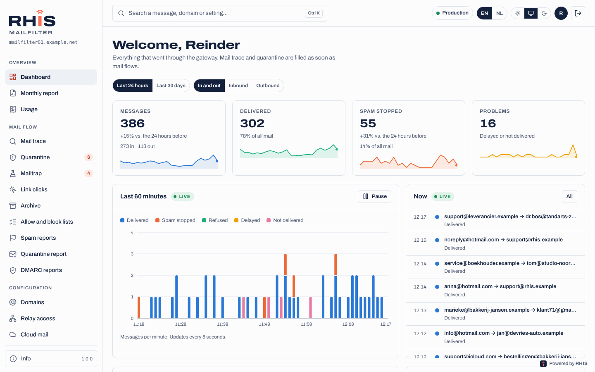

Beheerders zien alle domeinen: totalen van de laatste 24 uur of 30 dagen, een grafiek per uur of dag, de mailwachtrij (wordt verstuurd, wacht op nieuwe poging, in quarantaine), topafzenders en top-ontvangende domeinen, en **Wat opvalt**:

| Melding | Wat te doen |
| --- | --- |
| Mail aan een domein wacht al meer dan een uur | De bestemmingsserver neemt geen mail aan. Mailfilter blijft het 5 dagen proberen. |
| Veel berichten niet afgeleverd in het afgelopen uur | Open de lijst en lees de redenen; vaak een blocklist of een kapotte bestemming. |
| Ongewoon veel mail verstuurd door een server | Mogelijk een gehackte website of mailbox. Controleer het; pauzeer of blokkeer onder Relay-toegang. |
| Afzenders gepauzeerd | Zie [automatische bescherming](#throttling-en-automatische-bescherming). |
| Veel berichten in de wachtrij | Bekijk de vertraagde mail in de mailtrace. |
| Dienst draait niet | Herstart hem of draai de installer opnieuw (`install.sh --reconfigure`). |
| Op een blocklist (grote rode balk) | Een van Mailfilters eigen IP-adressen staat op een blocklist. Het tabblad *Blacklistcontrole* in de DNS-toolbox toont welke, met een link naar het verwijderformulier. |

### Maandrapport

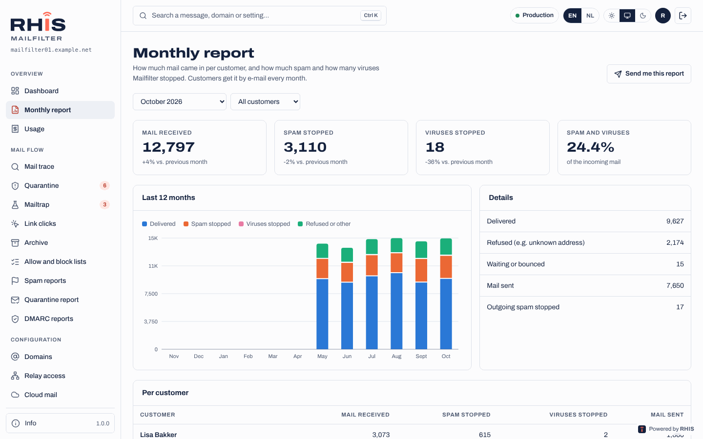

**Overzicht › Maandrapport** toont per klant hoeveel mail er binnenkwam en hoeveel spam en virussen er werden tegengehouden, per maand. Bij de instellingen:

- **Maandrapport versturen**: standaard uit. Kies de **dag van de maand** (1–28) en de **tijd**.
- **Stuur mij een overzicht van alle klanten**: elke beheerder krijgt één mail met de totalen per klant.
- **Stuur mij een voorbeeld** toont wat klanten krijgen. Elke klant krijgt het in zijn eigen taal en kan zijn eigen exemplaar uitzetten.

Afgelopen maanden worden bewaard, dus het rapport blijft beschikbaar na de 90 dagen van de mailtrace.

### Verbruik

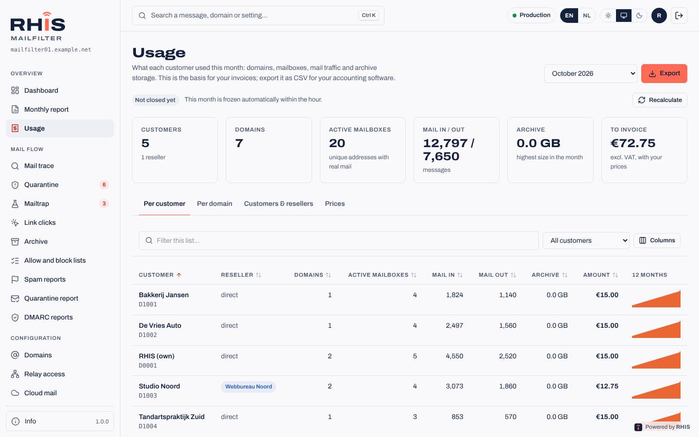

**Overzicht › Verbruik** is de basis voor de facturatie. Per klant en per domein: domeinen, **actieve mailboxen** (unieke adressen die in de maand echt mail ontvingen of verstuurden; alleen spam telt niet), berichten in en uit, en archiefopslag (de hoogste omvang in de maand).

- Tabblad **Tarieven**: prijs per domein, per actieve mailbox, per 1.000 berichten in of uit, per GB archief, een minimum en een vaste prijs per klant per maand (excl. btw). Klanten kunnen eigen prijzen hebben; resellers krijgen korting.
- Afgelopen maanden worden bevroren met de prijzen van dat moment. **Herberekenen** doet een maand opnieuw na een correctie.
- **Exporteren** als CSV (kies `;` met decimale komma voor Nederlandse Excel, of `,`), klaar voor je boekhoudpakket.

Klantlogins zien de aantallen zonder prijzen; resellerlogins zien alleen hun eigen klanten.

---

## Mailverkeer

### Mailtrace

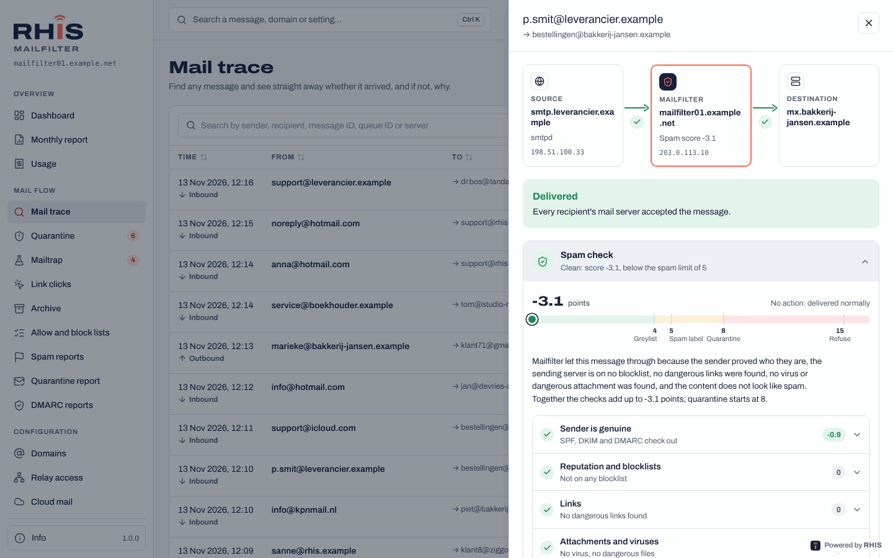

Zie de [gebruikershandleiding](gebruikershandleiding.md#4-mailtrace). Beheerders zien elk domein en ook het IP-adres en de hostnaam van de verzendende server, het SMTP-account en het letterlijke antwoord van de ontvangende server. De mailtrace wordt door `mailfilter-tracer` opgebouwd uit de logs van Postfix en Rspamd en 90 dagen bewaard.

### Quarantaine

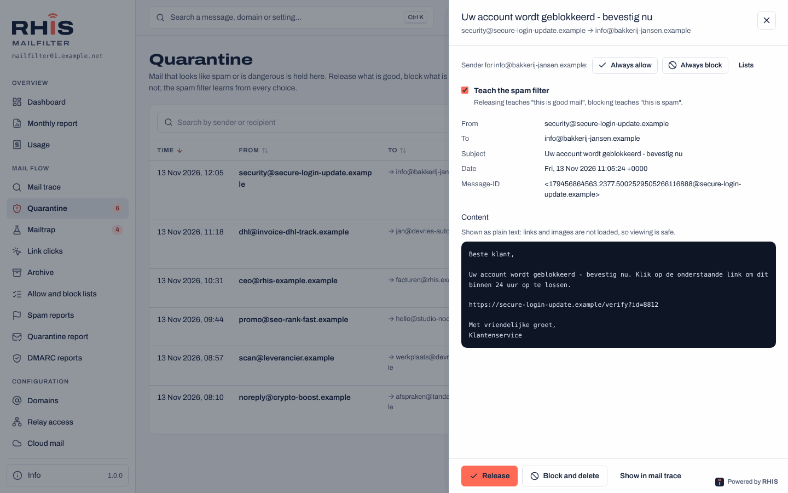

De quarantaine is de *hold*-wachtrij van Postfix: er gaat niets van de server af tot iemand beslist. Spam met een score van **8 of hoger** gaat in quarantaine, **15 of hoger** wordt aan de deur geweigerd; virussen en geblokkeerde bijlagen gaan in quarantaine. Vrijgeven leert Rspamd *ham*, blokkeren leert *spam*. Alleen beheerders kunnen een bericht met een virus vrijgeven.

### Mailtrap

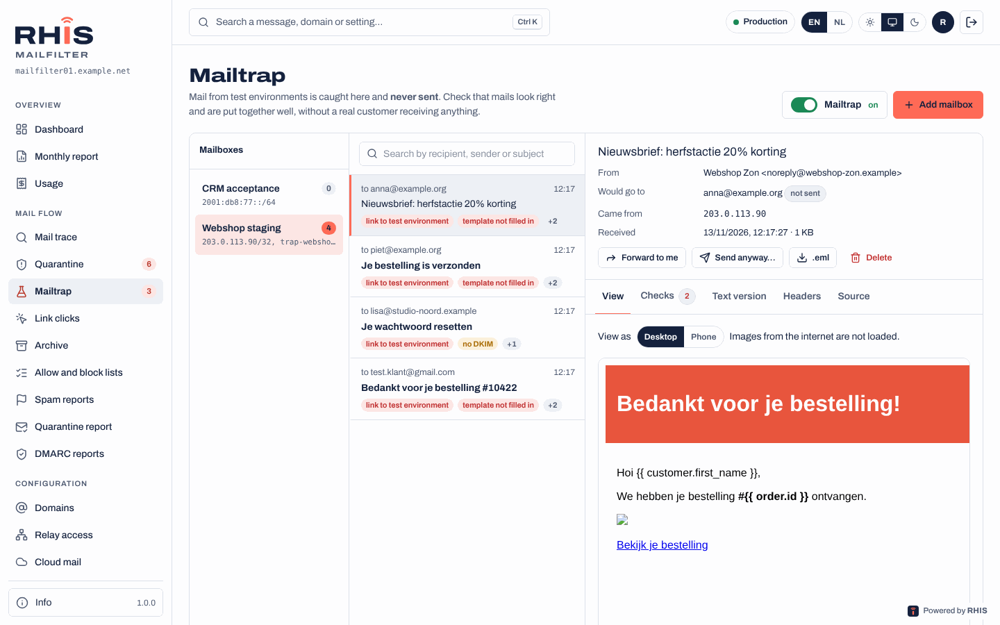

Een module die mail uit testomgevingen opvangt zodat die nooit verstuurd wordt. Hij staat **uit** tot een beheerder hem bovenaan **Mailverkeer › Mailtrap** aanzet; zolang hij uit staat wordt mail van Mailtrap-adressen en -logins geweigerd, nooit doorgestuurd.

Per mailbox: naam, klant, welke IP-adressen of netwerken worden opgevangen (een IP staat óf in Relay-toegang óf in een Mailtrap, nooit allebei), eventueel een login `trap-<naam>` voor omgevingen zonder vast IP, *alles opvangen* of *alles opvangen, behalve naar testers*, IMAP-toegang op poort 993, bewaartermijn (standaard 7 dagen) en maximaal aantal berichten (standaard 1000). Alleen beheerders kunnen **Toch versturen** (komt in het auditlog). Alle details: [Mailtrap](mailtrap.md).

### Archief

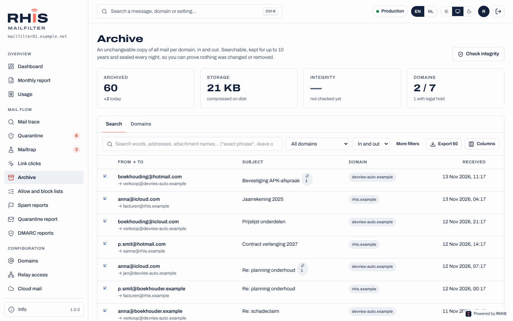

Zet het archief per domein aan op het tabblad **Domeinen** van **Mailverkeer › Archief**:

- **Bewaartermijn** 1 tot 10 jaar (standaard 7, de fiscale bewaarplicht), tot het eind van de maand. Een langere termijn geldt voor nieuwe mail; mail die al in het archief zit houdt minstens de termijn die hij had.
- **Juridische bewaarplicht** met een reden: er wordt niets van het domein verwijderd, ook niet na de bewaartermijn.
- **Integriteit controleren** berekent vingerafdrukken, de hashketen en de ondertekende dagzegels opnieuw. De nachtelijke taak doet dit ook en geeft een melding bij problemen.

Alleen mail die echt is afgeleverd of verstuurd wordt gearchiveerd (ook mail die uit de quarantaine is vrijgegeven). Gearchiveerde dagen worden op schijf vergrendeld (`chattr +i`) en verzegeld met de Ed25519-sleutel van de server, waarvan de publieke sleutel hier staat en in elke export zit. Elke zoekopdracht, weergave, download en export komt in het auditlog. Alle details: [archief](archief.md).

### Toestaan en blokkeren

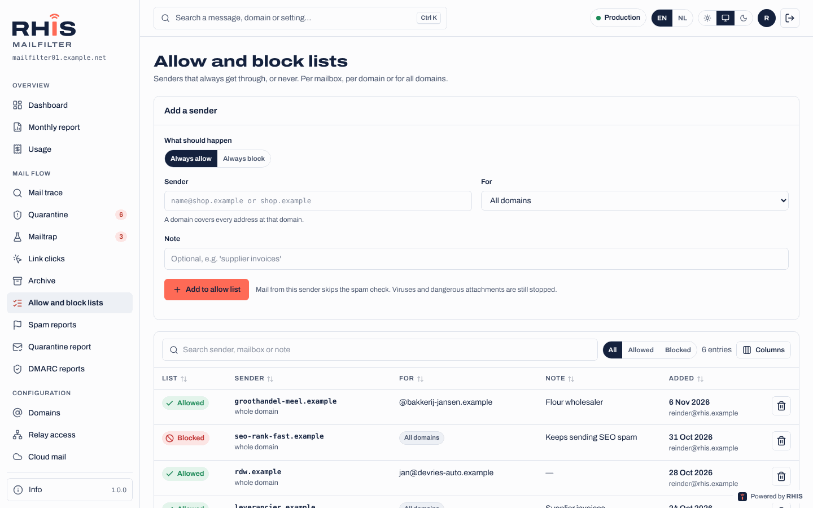

Regels gelden voor één mailbox, voor iedereen op een domein, of voor alle domeinen (alleen beheerders). Toegestane afzenders krijgen −20 op de spamscore (virussen en gevaarlijke bijlagen worden nog steeds tegengehouden); geblokkeerde afzenders worden geweigerd met *blokkeerlijst van de ontvanger*. Lijsten die uit PMG zijn geïmporteerd staan apart en werken gewoon.

### Spammeldingen

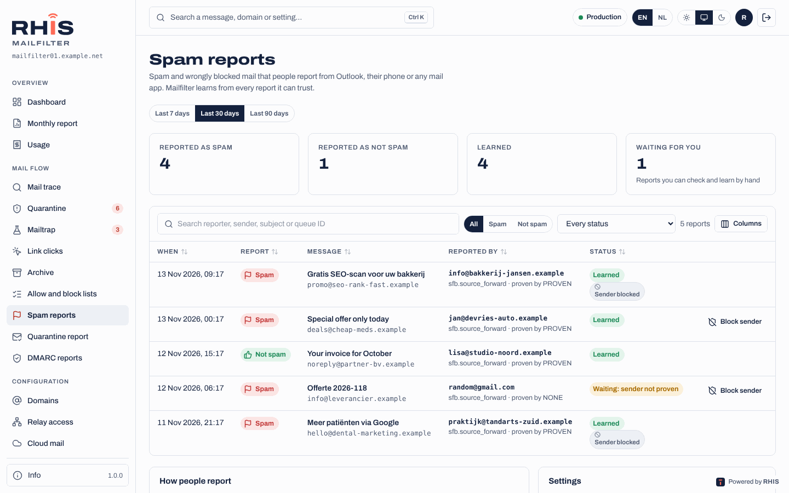

Gebruikers melden spam bij `spam@<hostnaam>` en goede mail bij `notspam@<hostnaam>` (zie de [gebruikershandleiding](gebruikershandleiding.md#8-spam-en-goede-mail-melden)). **Mailverkeer › Spammeldingen** toont elke melding met zijn status, en heeft deze instellingen:

- **Alleen bewezen meldingen vertrouwen**: de melding moet door DMARC komen, of een DKIM-handtekening of SPF-pass van het domein van de melder hebben. Andere meldingen wachten op een klik op **Leren**.
- **Afzender blokkeren voor de melder**: een geleerde spammelding zet de afzender ook op de blokkeerlijst van die mailbox. **Ongedaan maken** draait het terug.
- **Meldingen per persoon per uur**: meer worden getoond maar niet geleerd (0 = geen limiet).

Mailfilter leert alleen van mail die het zelf bij het domein van de melder heeft afgeleverd. Voor Microsoft 365 stel je in de tenant bij *door gebruikers gerapporteerde berichten* een mailbox in die doorstuurt naar `spam@<hostnaam>`; de pagina toont de stappen.

### Quarantaine-overzicht

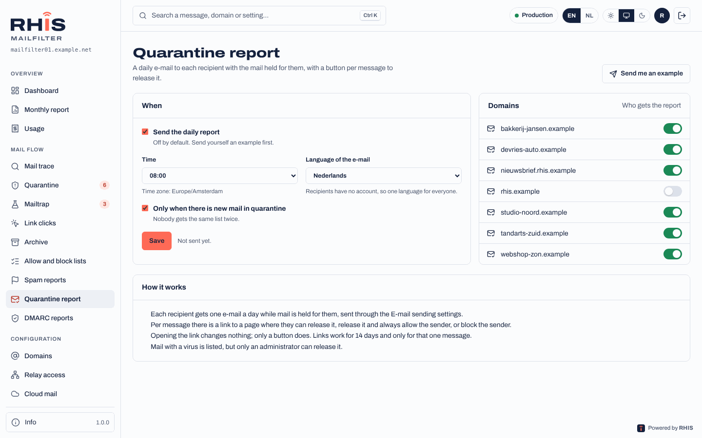

**Mailverkeer › Quarantaine-overzicht** stuurt elke ontvanger met vastgehouden mail één e-mail per dag:

- **Dagelijks overzicht versturen** (standaard uit), de **tijd**, de **taal van de e-mail** (één voor iedereen, ontvangers hebben geen account) en **Alleen als er nieuwe mail in quarantaine staat**.
- Per domein kies je wie het overzicht krijgt.
- **Stuur mij een voorbeeld** eerst.

De links in het overzicht werken 14 dagen en alleen voor dat bericht; een link openen verandert niets, alleen een knop doet iets.

### DMARC-rapporten

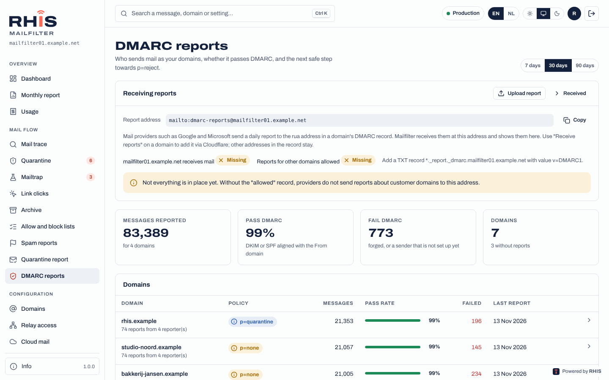

Mailfilter ontvangt DMARC-rapporten op `dmarc-reports@<hostnaam>`. Voeg `rua=mailto:dmarc-reports@<hostnaam>` toe aan het DMARC-record van een domein (de DNS-toolbox doet dit voor je) en publiceer één keer het autorisatierecord `*._report._dmarc.<hostnaam>`. Rapporten worden 400 dagen bewaard.

Per domein toont de pagina wie namens het domein verstuurt en de **weg naar p=reject**: minstens 7 dagen rapporten verzamelen met `p=none`, de echte afzenders die falen oplossen, naar `quarantine`, 14 dagen wachten, dan `reject`. Met Cloudflare is elke stap één knop.

---

## Configuratie

### Domeinen

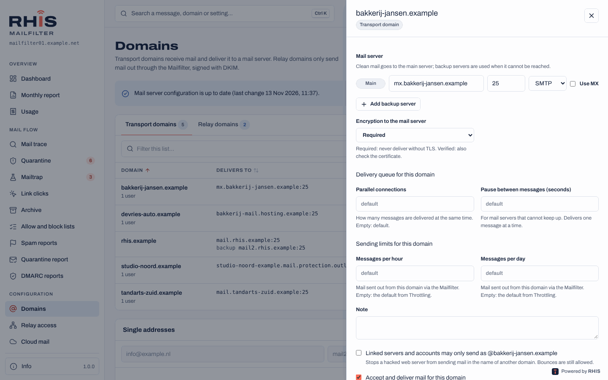

**Configuratie › Domeinen** kent twee soorten:

| | Transportdomein | Relaydomein |
| --- | --- | --- |
| Inkomende mail | Aangenomen, gefilterd en afgeleverd bij de mailserver van het domein | Niet aangenomen |
| Uitgaande mail | Gecontroleerd, met DKIM ondertekend, begrensd | Gecontroleerd, met DKIM ondertekend, begrensd |

**Domein toevoegen** vraagt eerst de soort. Een domein kan later worden omgezet. Voor een **transportdomein**:

- **Mailserver**: hostnaam of IP, poort, *MX gebruiken* (de MX van de hostnaam opzoeken), plus **reserveservers** die gebruikt worden als de hoofdserver onbereikbaar is.
- **Versleuteling naar de mailserver**: als het kan, verplicht, of verplicht en gecontroleerd.
- **Ontvangers**: hoe Mailfilter controleert of een adres bestaat voordat het mail aanneemt:
  - **Vraag het de mailserver** (standaard): een SMTP-controle, met cache;
  - **LDAP / Active Directory**: server, base DN, bind-gebruiker en filter; het wachtwoord wordt versleuteld opgeslagen;
  - **Vaste lijst** met adressen;
  - **Uit**: alles aannemen (niet aanbevolen: backscatter).

  **Testen** probeert een adres en waarschuwt als de server verzonnen adressen aanneemt.
- **Wachtrij voor dit domein**: parallelle verbindingen en een pauze tussen berichten voor trage servers. Elk domein heeft zijn eigen wachtrij, dus één trage server houdt de rest nooit op.
- **Verzendlimieten voor dit domein**: berichten per uur en per dag.
- **Gebruikers met toegang**: de klanten die dit domein zien.
- **Losse adressen**: één adres (of subdomein) ergens anders afleveren.
- **Versleuteling per bestemming**: TLS, DANE of een gecontroleerd certificaat verplichten voor bepaalde ontvangende domeinen (bijvoorbeeld banken).

Bij een **relaydomein** koppel je de relay-IP's en **SMTP-accounts** die namens het domein mogen versturen, stel je de **afzenderslot** in (*gekoppelde servers en accounts mogen alleen versturen als @domein*) en publiceer je DKIM, SPF en DMARC. Zie [relaydomeinen](relay-domeinen.md).

Bij het opslaan van een domein wordt de DKIM-sleutel gemaakt. Elke wijziging wordt gecontroleerd (geen open relay, geen mailloops) en getest met `postfix check` en `rspamadm configtest` voordat hij wordt toegepast; bij een fout verandert er niets en krijg je de reden.

### Relay-toegang

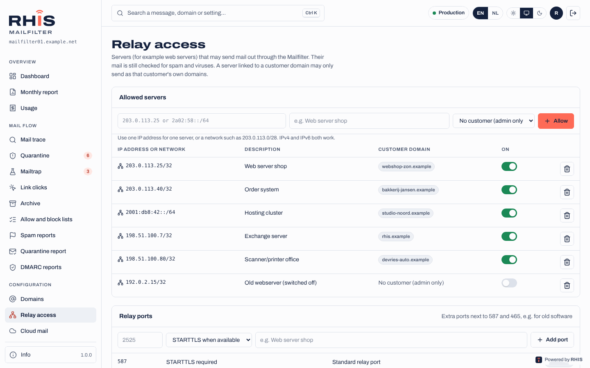

**Configuratie › Relay-toegang** toont de servers die via Mailfilter mail naar buiten mogen sturen.

- **Toestaan**: een IP-adres of netwerk (IPv4 of IPv6) met een omschrijving en, voor servers van een klant, het **klantdomein**. Een server die aan een klant gekoppeld is mag alleen versturen namens de domeinen van die klant. Grote netwerken vragen een extra bevestiging.
- Elke regel kan worden uitgezet zonder hem te verwijderen.
- **Relaypoorten**: 587 (STARTTLS) en 465 (TLS) staan altijd aan. Voeg extra poorten toe, bijvoorbeeld 2525 voor oude software, met *STARTTLS als het kan*, *STARTTLS verplicht* of *Direct TLS*. De firewall opent ze automatisch.

Mail via de relay wordt nog steeds op spam en virussen gecontroleerd, met DKIM ondertekend en begrensd.

### Cloud-mail (Microsoft 365 en Google Workspace)

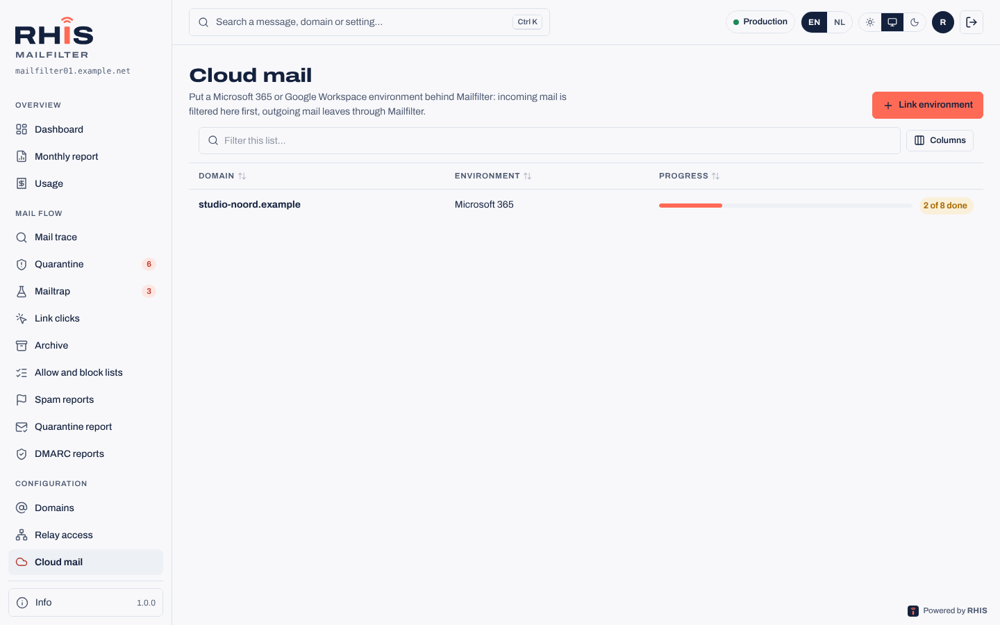

**Configuratie › Cloud-mail** zet een domein in Microsoft 365 of Google Workspace achter Mailfilter met een wizard van 8 stappen. Elke stap toont precies wat je moet aanklikken of welke PowerShell je moet plakken, en Mailfilter controleert het resultaat.

| Microsoft 365 | Google Workspace |
| --- | --- |
| 1. Domein en tenant (herkend via DNS) | 1. Domein |
| 2. Mailfilter instellen (transportdomein, aflevering bij de tenant) | 2. Mailfilter instellen |
| 3. Inkomende connector | 3. DKIM in Google |
| 4. Enhanced Filtering (zodat M365 het echte IP van de afzender ziet) | 4. Inkomende gateway |
| 5. Uitgaande connector (uitgaande mail via Mailfilter) | 5. Uitgaande gateway |
| 6. Testen | 6. Testen |
| 7. DNS wijzigen (MX, SPF) | 7. DNS wijzigen (MX, SPF) |
| 8. Afsluiten (alleen nog mail van Mailfilter aannemen, na 48 uur) | 8. Afsluiten |

Beveiliging: de IP-reeksen van Microsoft en Google worden **niet** aan Relay-toegang toegevoegd. Mail die vanuit de cloud wordt doorgestuurd wordt alleen aangenomen voor de gekoppelde domeinen, en alleen als hij de tenant-ID (M365) of een geldige DKIM-handtekening van het domein (Google) heeft. De provider ondertekent zijn eigen uitgaande mail met DKIM.

### Eigen regels

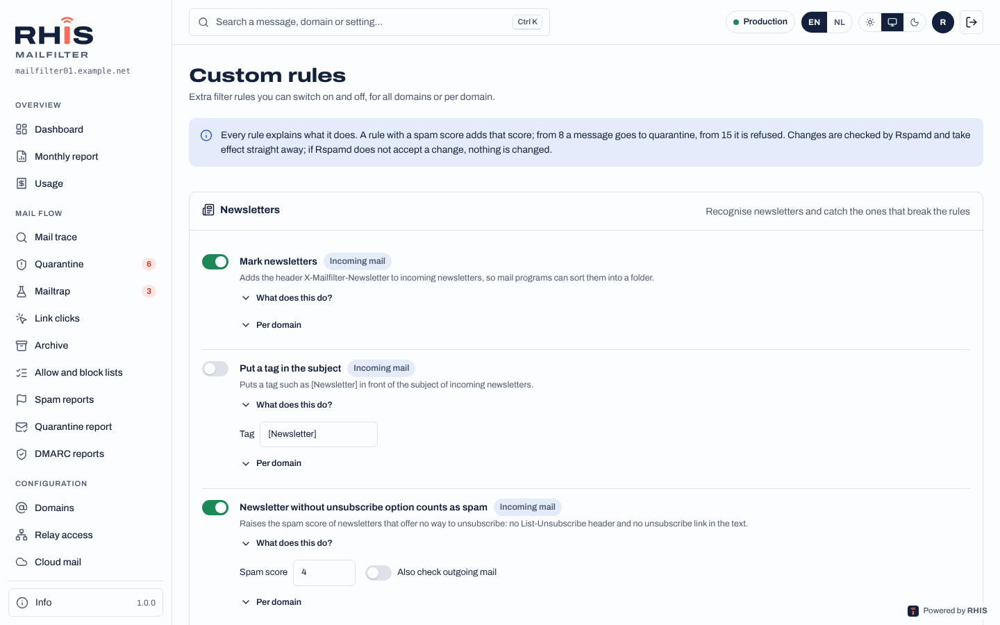

**Configuratie › Eigen regels** bevat regels die je aan- en uitzet, in vier groepen. Elke regel legt uit wat hij doet, toont de naam waarmee hij in de mailtrace staat, en kan aan of uit voor alle domeinen, met een uitzondering per domein (klanten kunnen kiezen voor hun eigen domeinen). Regels met een score tellen op bij de spamscore.

| Groep | Regels |
| --- | --- |
| **Nieuwsbrieven** | Nieuwsbrieven markeren, nieuwsbrief zonder afmeldlink (+4), zonder afmelden met één klik, zonder DKIM, header `X-Mailfilter-Newsletter`, optioneel label in het onderwerp |
| **Phishing en CEO-fraude** | Lookalikes van je eigen domeinen, afzendernamen die zich voordoen als je eigen mensen (met een lijst beschermde namen), verdachte links, banner *externe afzender*, linkbescherming |
| **Bijlagen** | Gevaarlijke bestandstypen blokkeren of in quarantaine (lijst aan te passen), Office-macro's, versleutelde archieven |
| **Doorgestuurde mail (ARC)** | ARC-zegels van bekende doorstuurders vertrouwen (standaard Google, Microsoft, Yahoo, iCloud) zodat doorgestuurde mail door DMARC blijft komen |

De banner en het label in het onderwerp veranderen het bericht en breken daardoor de DKIM-handtekening van de afzender; ze staan standaard uit.

**Linkbescherming** (standaard uit): links in binnenkomende mail worden herschreven zodat ze via Mailfilter lopen. Als iemand klikt, wordt de link op dat moment opnieuw gecontroleerd (blocklists, lookalike-domeinen, verkorte URL's uitgepakt); bij een gevaarlijke link volgt een waarschuwingspagina. Je kiest of gebruikers toch door mogen, welke afzenders en links worden overgeslagen en welke altijd worden geblokkeerd. Kliks staan op een eigen pagina.

### Throttling en automatische bescherming

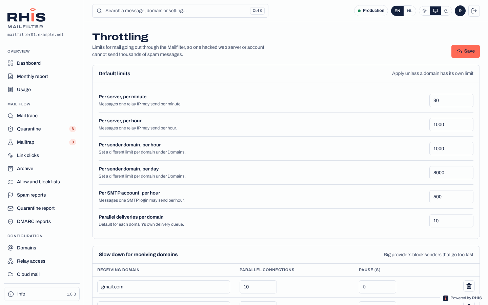

**Configuratie › Throttling** begrenst uitgaande mail zodat één gehackte server of account geen duizenden spamberichten kan versturen.

- **Standaardlimieten**: per server per minuut en per uur, per afzenderdomein per uur en per dag, per SMTP-account per uur, en parallelle afleveringen per domein. Domeinen kunnen eigen limieten hebben.
- **Afremmen voor ontvangende domeinen**: minder parallelle verbindingen en een pauze tussen berichten voor grote providers die afzenders blokkeren die te snel gaan.

**Automatische bescherming** controleert elke minuut de uitgaande mail van elke server en elk SMTP-account en **pauzeert** een afzender die plotseling spam of veel meer dan normaal verstuurt. Zijn mail wordt vastgehouden; er gaat niets verloren of de deur uit.

| Instelling | Betekenis |
| --- | --- |
| Afzenders automatisch pauzeren | Uit: er wordt niets automatisch gepauzeerd (met de hand kan nog wel) |
| Terugkijken (minuten) | Hoeveel minuten mail elke keer wordt bekeken |
| Spam: minstens zoveel berichten / dit deel (%) | Beide moeten gehaald worden |
| Volume: minstens zoveel berichten / keer de normale hoeveelheid | Vergeleken met het gemiddelde van de laatste 7 dagen; kleine afzenders worden nooit op volume gepauzeerd |
| Met rust laten na vrijgeven (uren) | Zodat een vrijgegeven afzender niet meteen weer wordt gepauzeerd |
| Nooit pauzeren | IP-adressen of SMTP-accounts |
| Ook waarschuwen | Extra adressen naast de ontvangers van meldingen |

Geef een gepauzeerde afzender vrij onder **Relay-toegang** zodra de oorzaak is opgelost: **Vrijgeven en vastgehouden mail versturen** of **Vrijgeven en vastgehouden mail verwijderen**.

### DNS-toolbox

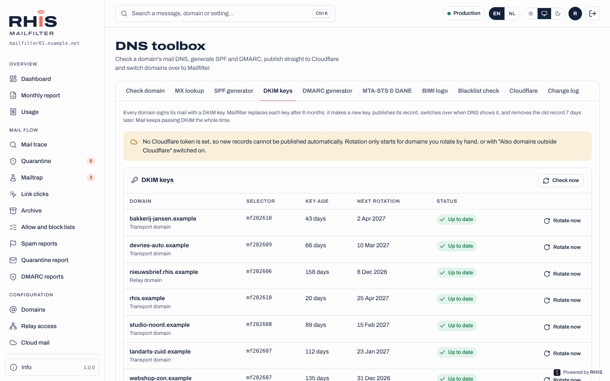

**Configuratie › DNS-toolbox** heeft deze tabbladen:

| Tabblad | Wat het doet |
| --- | --- |
| **Domein controleren** | Controleert MX, SPF, DKIM, DMARC, MTA-STS, TLS-RPT en BIMI van een domein bij zijn eigen gezaghebbende nameservers, met een herstelknop per onderdeel |
| **MX-lookup** | MX-records van elk domein, ook van klanten die niet op Mailfilter staan. Met Cloudflare kun je hier de MX van een domein wijzigen |
| **SPF-generator** | Bouwt een SPF-record; *Mailfilter aan bestaande SPF toevoegen* houdt de huidige waarde en voegt `include:_spf.<hostnaam>` toe. Telt de DNS-lookups (max. 10) |
| **DMARC-generator** | Bouwt een DMARC-record met rapporten naar Mailfilter |
| **Blacklistcontrole** | Mailfilters eigen IPv4- en IPv6-adressen tegen de grote blocklists, elke 15 minuten; een vermelding geeft een rode balk op het dashboard |
| **DKIM-sleutels** | Sleutel en selector van elk domein, en **automatische rotatie** |
| **BIMI-logo** | Upload een logo; Mailfilter zet het om naar SVG Tiny PS, controleert een VMC/CMC-certificaat en publiceert `default._bimi` |
| **MTA-STS en DANE** | MTA-STS-beleid (testing of enforce) gehost door Mailfilter, TLS-RPT-rapporten, DANE TLSA-record voor de server |
| **Cloudflare** | API-token (*Zone:Read* + *DNS:Edit*), versleuteld opgeslagen |
| **Wijzigingslog** | Elke DNS-wijziging die Mailfilter deed, met de oude waarde en **Ongedaan maken** per batch |

**Publiceren**: met Cloudflare publiceer je elk record met één knop. Je ziet altijd eerst het plan (wat wordt toegevoegd, gewijzigd of verwijderd) voordat het wordt toegepast. Zonder Cloudflare kopieer je het record naar je DNS-provider en druk je op **Opnieuw controleren**.

**SPF**: elk domein krijgt `include:_spf.<hostnaam>`. Dat ene gedeelde record bevat alle IP-adressen van Mailfilter, dus een server toevoegen aan een cluster wijzigt maar één record.

**Go live** (per domein, één keer): zet de MX van het domein in Cloudflare om naar Mailfilter. Het wordt gelogd en kan worden teruggedraaid.

**DKIM-rotatie**: een nieuwe sleutel met selector `mfJJJJMM` wordt gepubliceerd, na 48 uur gebruikt, en de oude sleutel blijft nog 7 dagen geldig voordat hij wordt verwijderd. Alleen automatisch voor live domeinen in Cloudflare, tenzij je *handmatige DNS* kiest. Zie [DKIM-sleutelrotatie](dkim-rotatie.md).

**BIMI**: Gmail en Apple Mail vereisen een betaald VMC- of CMC-certificaat; Yahoo en anderen tonen het logo met een afgedwongen DMARC-beleid en alleen het record.

---

## Systeem

### Gebruikers

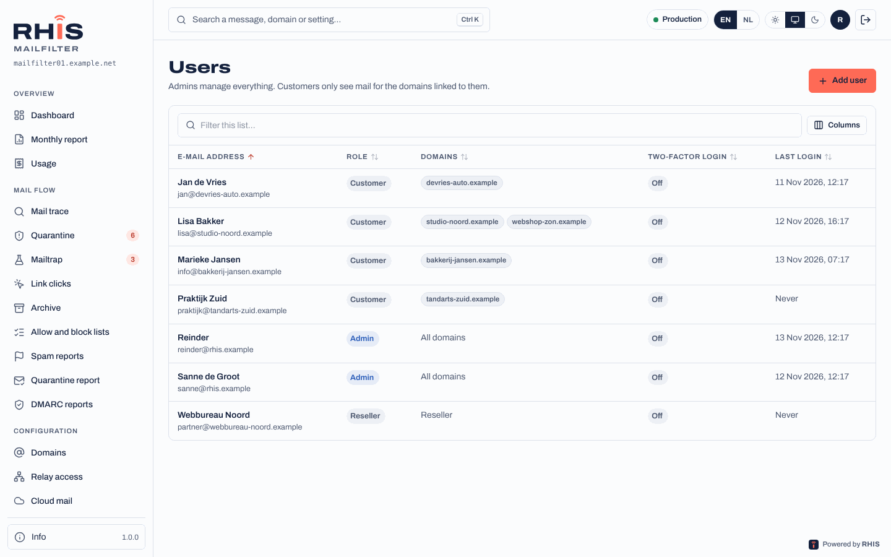

**Systeem › Gebruikers**: logins toevoegen, wijzigen en uitschakelen.

- **Rol**: *Beheerder* (alles), *Klant* (alleen de gekoppelde **domeinen**) of *Reseller* (alleen het verbruik van de eigen klanten).
- **Taal** van de interface en van de mails die de gebruiker krijgt.
- **Wachtwoord**: laat leeg om er een te genereren; het wordt één keer getoond.
- **2FA resetten** als iemand zijn telefoon en herstelcodes kwijt is.

### Klanten en resellers

**Systeem › Klanten & resellers** legt vast wie betaalt: een **klant** is een organisatie (naam en debiteurnummer) die domeinen heeft; één domein heeft één betaler. Een **reseller** verkoopt aan zijn eigen klanten en krijgt één factuur voor allemaal, met een kortingspercentage. Geef een reseller een login met de rol *Reseller*.

### Beveiliging

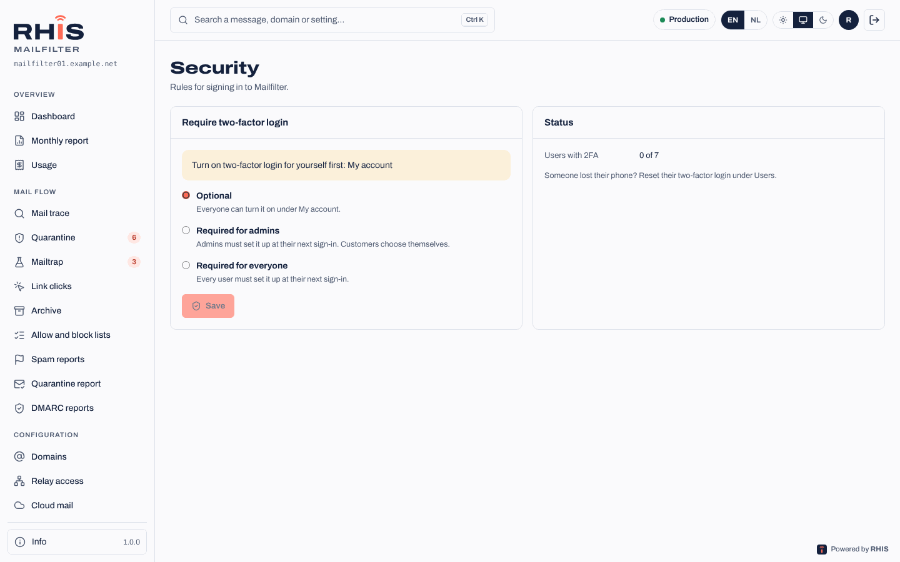

**Systeem › Beveiliging › Tweestapsverificatie verplichten**: *Optioneel*, *Verplicht voor beheerders* of *Verplicht voor iedereen*. Zet het eerst voor jezelf aan. Gebruikers zonder worden bij de volgende keer inloggen gevraagd het in te stellen; de pagina toont wie dat nog moet doen. In noodgevallen op de server: `mailfilter-admin reset-2fa EMAIL`.

### Huisstijl

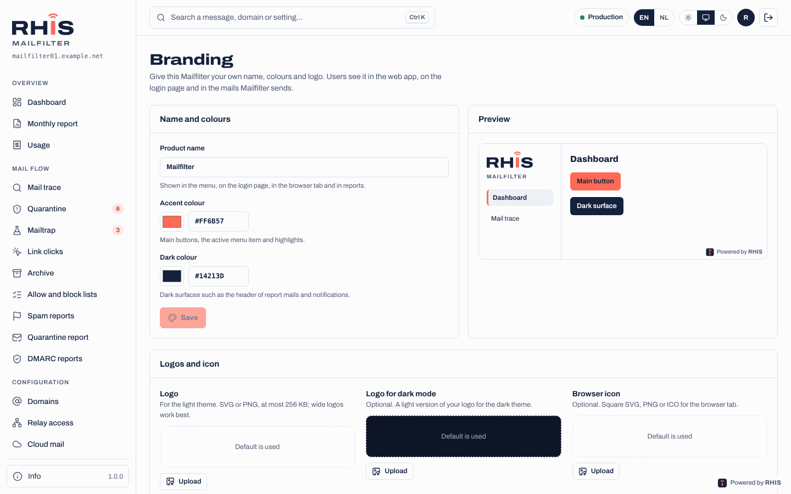

**Systeem › Huisstijl** geeft deze Mailfilter je eigen uiterlijk: productnaam, accentkleur (hoofdknoppen, actief menu-item), donkere kleur (kop van rapportmails), een logo, optioneel een licht logo voor donkere modus en een browsericoon (SVG, PNG, WebP, JPEG of ICO, maximaal 256 KB per bestand). Het voorbeeld laat het resultaat zien voordat je opslaat. Naam en kleuren worden ook gebruikt in het quarantaine-overzicht, het maandrapport en de pagina's van linkbescherming. **Terug naar standaard** zet de RHIS-huisstijl terug. In een cluster gaat de huisstijl mee naar de andere servers.

Het kleine "Powered by RHIS" rechtsonder op elke pagina is geen instelling: het is een voorwaarde van de open-source licentie (zie `NOTICE`).

### Auditlog

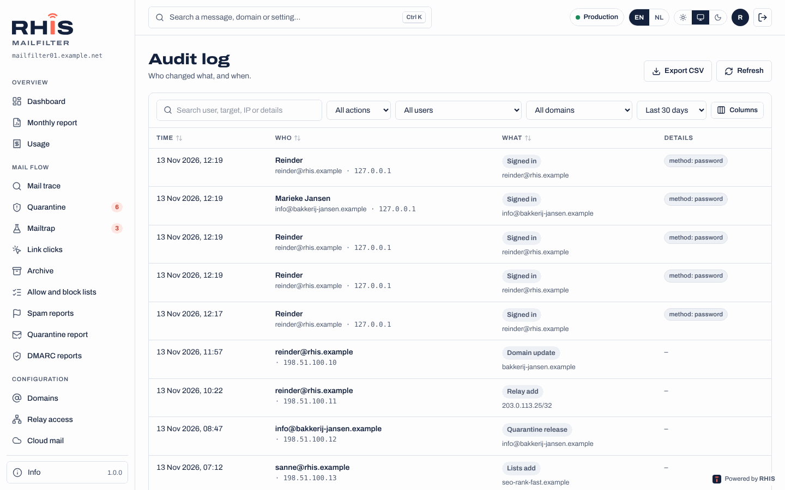

Elke wijziging in de webinterface en de API wordt vastgelegd met gebruiker, tijd, domein, IP-adres en details. Filter op gebruiker, soort actie, domein en periode; exporteer als CSV. Acties met een API-sleutel zijn gemarkeerd met *via API-sleutel*.

### API

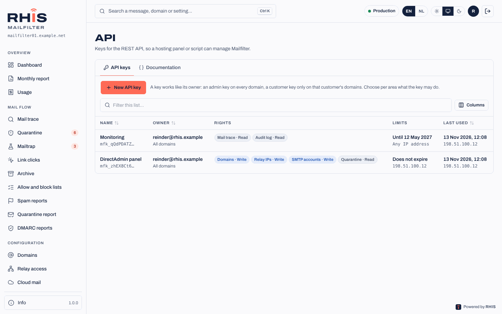

**Systeem › API**: REST API op `https://<hostnaam>/api/v1/` voor hostingpanelen en scripts.

- Sleutels (`mfk_…`) werken als hun eigenaar (beheerder: alle domeinen; klant: eigen domeinen), met rechten per onderdeel (domeinen, relay, SMTP-accounts, quarantaine, mailtrace, lijsten, gebruikers, audit: geen, lezen of schrijven), optionele IP-beperking en vervaldatum. Alleen een hash wordt opgeslagen. Limiet: 600 aanvragen per minuut.
- Het tabblad **Documentatie** toont de OpenAPI-beschrijving (`/api/v1/openapi.json`) met een voorbeeld bij elke aanroep.

Zie [REST API](api.md).

### E-mail verzenden

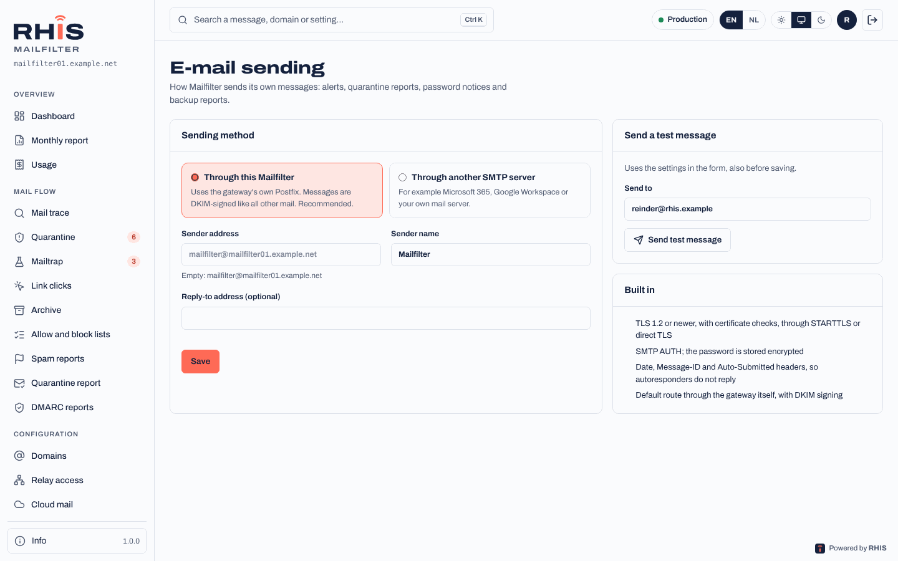

**Systeem › E-mail verzenden**: hoe Mailfilter zijn eigen mail verstuurt (meldingen, rapporten, quarantaine-overzichten):

- **Via deze Mailfilter** (standaard, aanbevolen): met DKIM ondertekend zoals alle andere mail.
- **Via een andere SMTP-server**: host, poort, STARTTLS of TLS, gebruikersnaam en wachtwoord (versleuteld opgeslagen).

**Testbericht versturen** probeert de instellingen in het formulier, ook voor het opslaan, en legt in gewone taal uit wat er misging.

### Meldingen

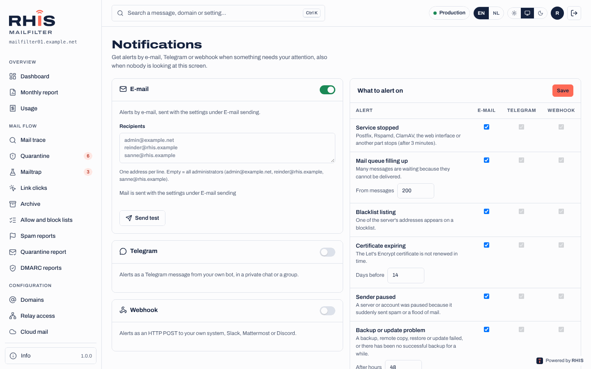

**Systeem › Meldingen** stuurt waarschuwingen als er iets aandacht nodig heeft, ook als niemand kijkt:

- **E-mail**: naar de opgegeven adressen, of alle beheerders.
- **Telegram**: maak een bot met @BotFather, stuur hem een bericht, plak het token en druk op **Chat zoeken**.
- **Webhook**: JSON voor je eigen systeem, Slack/Mattermost of Discord, eventueel ondertekend (`X-Mailfilter-Signature: sha256=HMAC(secret, timestamp + "." + body)`).

Per soort melding kies je de kanalen en drempels:

| Melding | Wanneer |
| --- | --- |
| Dienst gestopt | Postfix, Rspamd, ClamAV, de webinterface of een ander onderdeel ligt al 3 minuten stil |
| Mailwachtrij loopt vol | Meer dan *n* berichten wachten |
| Op een blacklist | Een van de adressen van de server staat op een blocklist |
| Certificaat verloopt | Het Let's Encrypt-certificaat is *n* dagen voor het verlopen niet vernieuwd |
| Afzender gepauzeerd | Automatische bescherming heeft een server of account gepauzeerd |
| Backup- of updateprobleem | Een backup, externe kopie, terugzetting of update mislukte, of al *n* uur geen geslaagde backup; ook integriteitsproblemen in het archief |

Algemeen: taal van de meldingen, **herinneren elke** *n* uur zolang een probleem duurt, **melden als het opgelost is**. **Test versturen** per kanaal, en lijsten met huidige problemen en recent verstuurde meldingen.

### Cluster

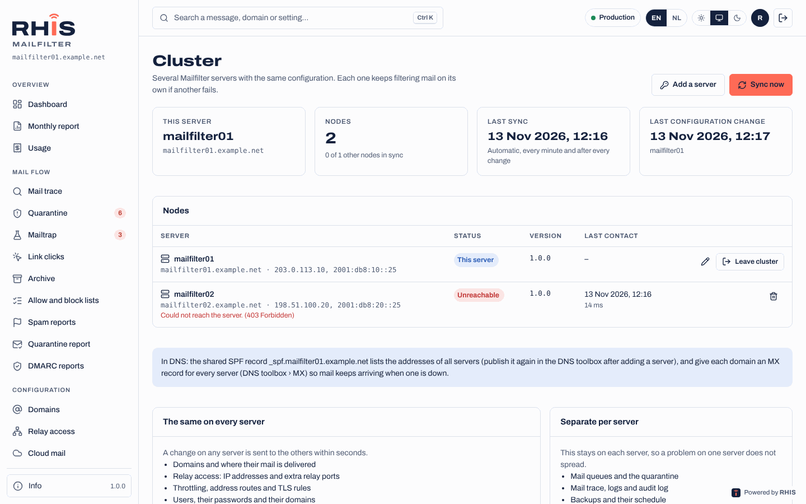

**Systeem › Cluster** houdt meerdere Mailfilter-servers op dezelfde configuratie. Elke server blijft een volledige gateway: valt er één uit, dan blijven de andere filteren, en hij haalt alles in zodra hij terug is.

1. Op de eerste server: **Cluster aanmaken**.
2. Installeer Mailfilter op de nieuwe server.
3. Op de eerste server: **Server toevoegen** en kopieer de koppelcode.
4. Op de nieuwe server: **Aansluiten bij een bestaand cluster** en plak de code.

Publiceer daarna het gedeelde SPF-record opnieuw en geef elk domein een MX voor elke server. Domeinen, relay-toegang, throttling, gebruikers (met 2FA), lijsten, regels, API-sleutels, facturatie en DKIM-sleutels worden gesynchroniseerd; wachtrijen, quarantaine, mailtrace, backups, Mailtrap-mailboxen en gearchiveerde mail blijven per server. Zie [cluster](cluster.md).

### Backups

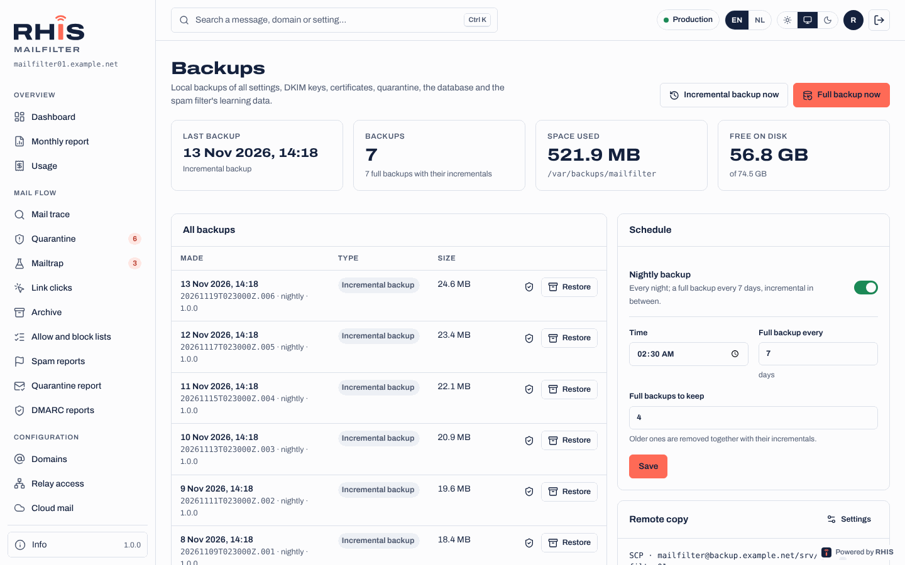

**Systeem › Backups**:

- Lijst met **backups**: elke volledige en incrementele backup met grootte en status; **Nu volledige backup**, **Nu incrementele backup**, **Controleren of de backup compleet is**, **Terugzetten**, **Verwijderen**.
- **Planning**: tijd van de nachtelijke backup, elke *n* dagen een nieuwe volledige backup (standaard 7), *n* volledige backups met hun incrementele bewaren (standaard 4).
- **Externe kopie**: **SCP/SFTP** (aanbevolen; Mailfilter toont zijn publieke sleutel voor `authorized_keys` en legt de vingerafdruk van de server vast), **FTPS** (expliciete TLS 1.2+) of **FTP** (alleen in vertrouwde netwerken). Bestanden worden vóór het uploaden versleuteld met AES-256. **Bewaar de wachtwoordzin in je wachtwoordmanager**: je hebt hem nodig om op een nieuwe server terug te zetten. Na elke backup wordt het nieuwe deel geüpload; **Nu kopiëren** haalt achterstand in.
- **Terugzetten vanaf de externe locatie** downloadt, controleert en zet een backup direct vanaf de externe server terug, ook op een vers geïnstalleerde server (stel eerst de externe locatie in met dezelfde wachtwoordzin).

Een backup bevat alle instellingen, DKIM-sleutels, certificaten, quarantaine, de database en de leergegevens van het spamfilter. Terugzetten maakt eerst een veiligheidsbackup. Zie [updates en backups](updates-en-backups.md).

### Import uit PMG

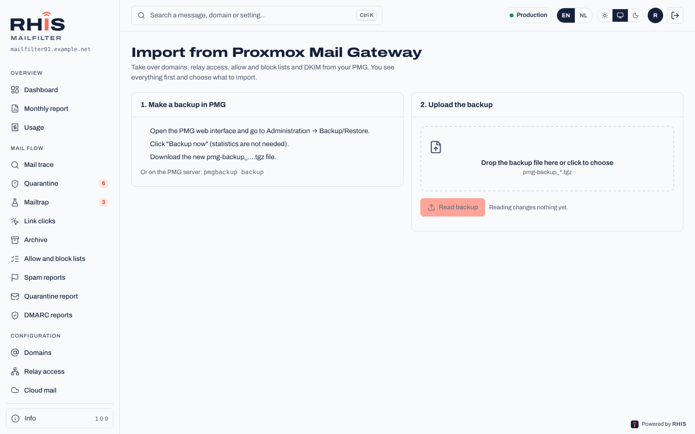

**Systeem › Import uit PMG** neemt een Proxmox Mail Gateway over:

1. Maak in PMG een backup (*Configuration › Backup/Restore*) en download de `.tgz`.
2. Upload hem hier. Mailfilter toont per tabblad alles wat het vond: domeinen, netwerken die mogen relayen, adresroutes, TLS-regels, toestaan- en blokkeerlijsten, DKIM-sleutels, PMG-regels en instellingen.
3. Vink aan wat je wilt importeren en druk op **Importeren**.

Eigen PMG-regels, quarantainelijsten per gebruiker, LDAP-instellingen, gebruikers en eigen SpamAssassin-regels worden niet omgezet; ze worden getoond om met de hand na te lopen. De MX van de domeinen zet je daarna om met **Go live** in de DNS-toolbox.

### Info en updates

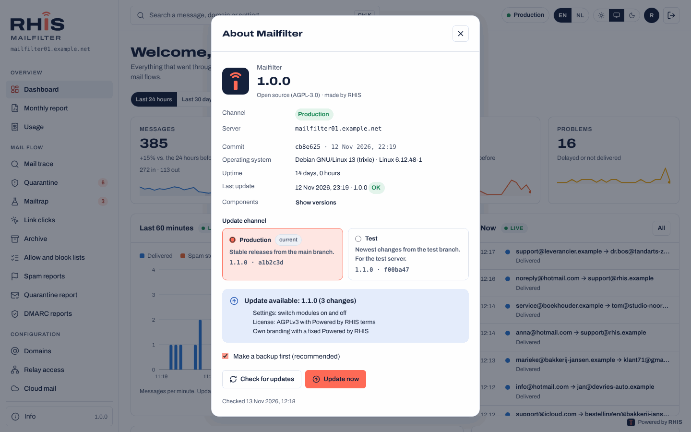

**Info** (onderaan het linkermenu) toont de versie, het kanaal, de commit, de server, het besturingssysteem, de uptime, de laatste update en de versies van alle onderdelen.

- **Controleren op updates** toont de nieuwste versie van beide kanalen en de wijzigingen sinds jouw versie.
- **Nu updaten** maakt een backup (**Eerst een backup maken**, standaard aangevinkt), installeert de nieuwe versie, draait de installer met de opgeslagen instellingen en **draait zichzelf terug** als dat misgaat. Mail wacht zolang in de wachtrij.
- **Updatekanaal**: wissel tussen **Productie** (`main`, stabiele releases) en **Test** (`test`, nieuwste wijzigingen, voor de testserver).

De bovenbalk toont een groen label *Productie* of een blauw label *Test*, zodat je altijd weet waar je zit.

---

## Hoe een bericht gefilterd wordt

**Inkomend (poort 25)**

1. **postscreen** houdt bots en IP's op blocklists tegen voordat ze iets zeggen.
2. **Postfix** controleert of het domein van ons is en de ontvanger bestaat (ontvangercontrole), en dwingt het TLS-beleid af.
3. **Rspamd**: greylisting vanaf score 4, SPF, DKIM, DMARC, ARC, reputatie en blocklists, Bayes, fuzzy hashes, eigen regels, toestaan- en blokkeerlijsten. **ClamAV** scant op virussen.
4. Score onder 8: afgeleverd (spamheaders vanaf 5). 8–15, virus of geblokkeerde bijlage: **quarantaine**. 15 of hoger: **geweigerd**.
5. Afgeleverd via de eigen wachtrij van het domein bij zijn mailserver, met een kopie naar het archief als dat aanstaat.

**Uitgaand (587, 465, extra poorten)**

1. Afzender toegestaan via **Relay-toegang**, een **SMTP-account** of een **cloud-tenant**; afzenderslot gecontroleerd.
2. **Rspamd en ClamAV** controleren het bericht; **throttling** en **automatische bescherming** gelden.
3. **Met DKIM ondertekend** met de sleutel van het domein en afgeleverd, met DANE of MTA-STS waar de ontvanger dat ondersteunt.

## Naslag voor de server

| Pad | Inhoud |
| --- | --- |
| `/opt/mailfilter` | De git-checkout (branch `main` of `test`) |
| `/etc/mailfilter/` | Instellingen, lijsten, geheimen (`secrets.env`), backupinstellingen, hooks in `hooks.d/` |
| `/var/lib/mailfilter/` | Gegevens van de webapp, venv, Mailtrap-mailboxen, BIMI-bestanden, DNS-journaal |
| `/var/lib/mailfilter-archive/` | Het mailarchief |
| `/var/lib/rspamd/dkim/` | DKIM-sleutels |
| `/var/backups/mailfilter/` | Lokale backups |
| `/var/log/mailfilter-install.log` | Log van de laatste installerrun |

| Timer | Doet |
| --- | --- |
| `mailfilter-backup` | Nachtelijke backup en externe kopie |
| `mailfilter-notify` | Meldingen, elke 2 minuten |
| `mailfilter-abuse` | Automatische bescherming, elke minuut |
| `mailfilter-blacklist` | Blocklistcontrole van eigen IP's, elke 15 minuten |
| `mailfilter-quarantine-report` | Dagelijks quarantaine-overzicht, controle elk uur |
| `mailfilter-monthly-report` | Maandrapport en verbruik, controle elk uur |
| `mailfilter-dkim-rotate` | DKIM-rotatie, elke 6 uur |
| `mailfilter-archive` | Archiefzegels en onderhoud, 's nachts |
| `mailfilter-cluster` | Controle van de clustersync, elke minuut |

Handige opdrachten: zie de [README](../../README.nl.md#opdrachtregel).
