# Gebruikershandleiding

[English](../user-guide.md) · [Alle documentatie](README.md)

*De schermafbeeldingen tonen meestal de Engelse interface; die is volledig in het Nederlands beschikbaar via Mijn account › Taal.*

Deze handleiding is voor iedereen die dagelijks met Mailfilter werkt: klanten die hun eigen domeinen beheren, en beheerders die willen weten wat hun klanten zien. Instellingen die alleen beheerders kunnen wijzigen staan in de [beheerdershandleiding](beheerdershandleiding.md).

De schermnamen in deze handleiding zijn die van de Nederlandse interface. Werk je in het Engels, dan vind je de Engelse namen in de [Engelse handleiding](../user-guide.md).

**Inhoud**

1. [Inloggen en je account](#1-inloggen-en-je-account)
2. [Je weg vinden](#2-je-weg-vinden)
3. [Dashboard](#3-dashboard)
4. [Mailtrace](#4-mailtrace)
5. [Quarantaine](#5-quarantaine)
6. [Het dagelijkse quarantaine-overzicht](#6-het-dagelijkse-quarantaine-overzicht)
7. [Toestaan en blokkeren](#7-toestaan-en-blokkeren)
8. [Spam en goede mail melden](#8-spam-en-goede-mail-melden)
9. [DMARC-rapporten](#9-dmarc-rapporten)
10. [Je domeinen](#10-je-domeinen)
11. [Relay-toegang: servers die mail versturen](#11-relay-toegang-servers-die-mail-versturen)
12. [Eigen regels](#12-eigen-regels)
13. [Mailtrap](#13-mailtrap)
14. [Archief](#14-archief)
15. [Maandrapport en verbruik](#15-maandrapport-en-verbruik)
16. [API-sleutels](#16-api-sleutels)
17. [Auditlog](#17-auditlog)
18. [Wat de statussen betekenen](#18-wat-de-statussen-betekenen)
19. [Veelgestelde vragen](#19-veelgestelde-vragen)

## Wat je kunt zien

Mailfilter kent drie soorten logins:

| Rol | Ziet |
| --- | --- |
| **Beheerder** | Alles, op elk domein, en alle instellingen |
| **Klant** | Alleen mail van en naar de domeinen die aan het account gekoppeld zijn, en de instellingen van die domeinen |
| **Reseller** | Alleen het verbruik van de eigen klanten (voor de facturatie) |

Log je in als klant, dan is alles in deze handleiding beperkt tot je eigen domeinen.

## 1. Inloggen en je account

Open het adres dat je beheerder je gaf, bijvoorbeeld `https://mailfilter01.voorbeeld.nl/`, en log in met je e-mailadres en wachtwoord. De webinterface werkt alleen via HTTPS.

**Mijn account** (je initialen rechtsboven) bevat:

- **Naam** en **taal**: English of Nederlands. Je kunt ook op elk moment wisselen met **EN / NL** rechtsboven.
- **Wachtwoord wijzigen**: minimaal 10 tekens. Je andere sessies worden uitgelogd.
- **Tweestapsverificatie**: beschermt je account met een code van 6 cijfers uit een authenticator-app (Microsoft Authenticator, Google Authenticator, 1Password, Bitwarden, …).
  1. Druk op **Tweestapsverificatie instellen**.
  2. Scan de QR-code met de app (of typ de sleutel over).
  3. Vul de code in die de app toont en druk op **Aanzetten**.
  4. **Bewaar de herstelcodes.** Met elke code kun je één keer inloggen zonder je telefoon.

  Vanaf dan vraagt Mailfilter na je wachtwoord om een code. Telefoon kwijt? Gebruik een herstelcode, of vraag een beheerder om je tweestapsverificatie te resetten. Je beheerder kan tweestapsverificatie verplicht stellen; je wordt dan bij de volgende keer inloggen gevraagd het in te stellen.

Met de **thema**-knop rechtsboven kies je licht, donker of hetzelfde als je computer.

## 2. Je weg vinden

- Het **menu aan de linkerkant** heeft vier groepen: **Overzicht**, **Mailverkeer**, **Configuratie** en **Systeem**. Je ziet alleen wat je mag gebruiken. Op een telefoon opent het menu met de knop ☰.
- **Overal zoeken** met **Ctrl+K** (⌘K op een Mac) of de zoekbalk bovenaan: pagina's, domeinen, gebruikers en berichten.
- **Info** onderaan het menu toont de versie van Mailfilter en of het productie- of testkanaal draait.
- Lijsten hebben een **filter**, je **sorteert** door op een kolom te klikken en je kiest zelf welke **kolommen** je ziet; op een telefoon worden het kaarten.
- Wijzigingen worden opgeslagen als je op **Opslaan** drukt; een korte melding onderaan bevestigt het.

## 3. Dashboard

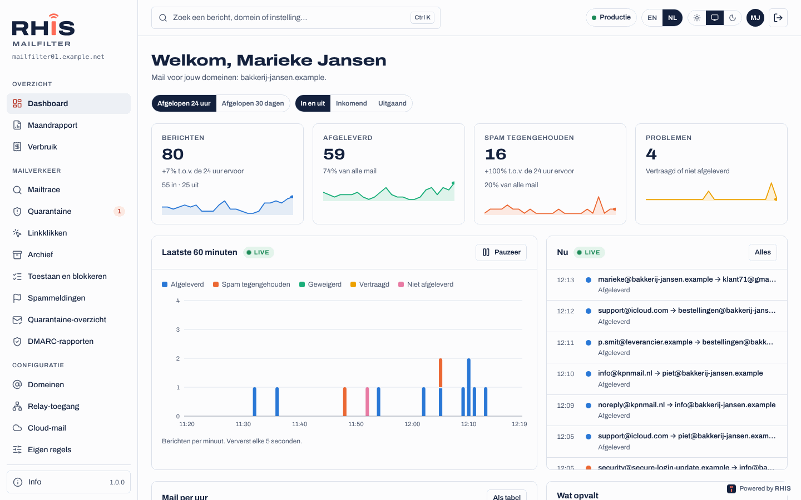

Het dashboard toont mail van de laatste 24 uur of de laatste 30 dagen:

- **Berichten** in en uit, **Afgeleverd**, **Spam tegengehouden**, **Problemen** (vertraagd of niet afgeleverd) en **In quarantaine**, elk vergeleken met de periode ervoor.
- Een grafiek van mail per uur of per dag, verdeeld in afgeleverd, spam tegengehouden, geweigerd, vertraagd en niet afgeleverd. **Als tabel** toont de getallen.
- **Wat opvalt**: mail die al meer dan een uur vastzit, veel bounces, een server die veel meer verstuurt dan normaal, een gepauzeerde afzender, berichten die in quarantaine wachten. Klik op een regel om direct naar de berichten te gaan.
- **Recente problemen**, **topafzenders** en **top-ontvangende domeinen**.

Beheerders zien ook de mailwachtrij, services die niet draaien en blocklistvermeldingen van de server.

## 4. Mailtrace

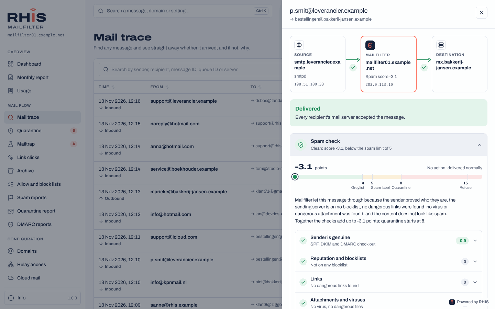

**Mailverkeer › Mailtrace** beantwoordt de vraag *is dit bericht aangekomen, en zo niet, waarom niet?*

1. Typ een **afzender, ontvanger, message-ID, queue-ID of servernaam** (of een deel ervan) in het zoekveld.
2. Verfijn op **status** (Afgeleverd, Alleen problemen, Vertraagd, Niet afgeleverd, In quarantaine, Geweigerd, Opgevangen in Mailtrap), **richting** (Inkomend, Uitgaand) en **periode** (laatste uur tot 90 dagen).
3. Klik op een bericht om het te openen.

Het berichtpaneel toont:

- Een **routeplaatje**: de verzendende server, Mailfilter (met de spamscore) en de bestemming, met een groen vinkje of rood kruis bij elke stap.
- **Per ontvanger** wat er gebeurde, met het antwoord van de ontvangende server en een uitleg **in gewone taal** van wat het betekent en **wie het kan oplossen**: de afzender, de ontvanger, de beheerder van Mailfilter, of *lost zich meestal vanzelf op* (Mailfilter blijft het proberen).
- Ontvangsttijd, queue-ID, grootte, spamscore, het SMTP-account waarmee verstuurd is, en koppelingen tussen een bericht en zijn bounces.
- **Spamcheck**: een checklist van alles waar het spamfilter naar keek (authenticatie, reputatie, links, bijlagen, inhoud, opmaak, beleid) met wat het vond en hoe zwaar dat telde. Zo zie je waarom een bericht werd doorgelaten of tegengehouden.
- Als het bericht in quarantaine zat: wie het vrijgaf of blokkeerde, en wat het spamfilter ervan leerde.

De mailtrace bewaart 90 dagen.

## 5. Quarantaine

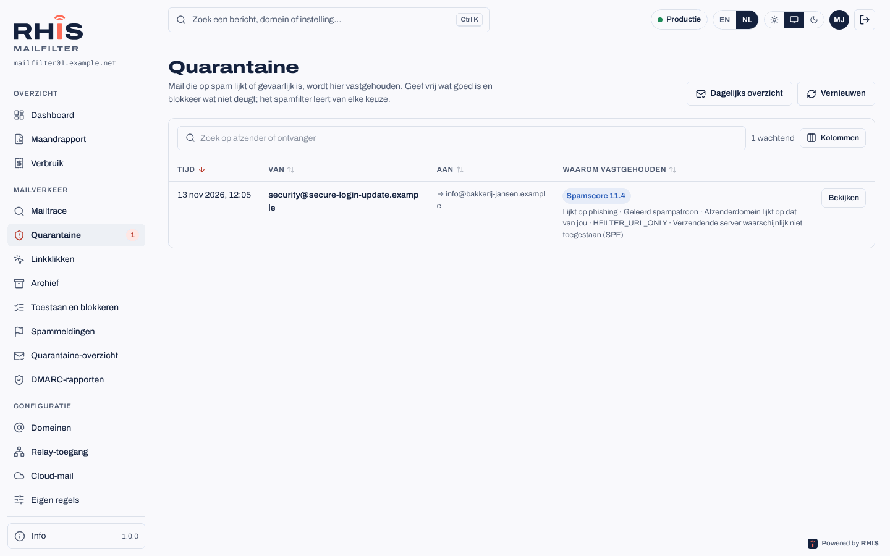

**Mailverkeer › Quarantaine** houdt mail vast die op spam lijkt of gevaarlijk is. Het getal naast het menu-item toont hoeveel berichten wachten.

- Klik op een bericht om te zien **waarom het werd vastgehouden** (spamscore, virus, geblokkeerde bijlage), de afzender, de ontvangers, de bijlagen en de **inhoud als platte tekst**. Links en afbeeldingen worden niet geladen, dus kijken is veilig.
- **Vrijgeven**: het bericht wordt direct afgeleverd, en het spamfilter leert *dit is goede mail*.
- **Blokkeren en verwijderen**: het bericht wordt verwijderd, en het spamfilter leert *dit is spam*.
- **Altijd toestaan** / **Altijd blokkeren** zet de afzender in één keer op de toestaan- of blokkeerlijst van die ontvanger.
- **Toon in mailtrace** opent de volledige geschiedenis.

Berichten met een **virus** kunnen alleen door een beheerder worden vrijgegeven.

## 6. Het dagelijkse quarantaine-overzicht

Als je beheerder het aanzet, krijgt iedere ontvanger met vastgehouden mail **één e-mail per dag** met die berichten. Bij elk bericht staat een knop die een kleine pagina opent (geen login nodig) met drie keuzes:

- **Alleen dit bericht vrijgeven**
- **Vrijgeven en deze afzender altijd toestaan**
- **Deze afzender blokkeren**

De link openen verandert niets; alleen een knop indrukken doet iets. Een link werkt 14 dagen en alleen voor dat ene bericht. Mail met een virus staat in de lijst, maar alleen een beheerder kan hem vrijgeven.

## 7. Toestaan en blokkeren

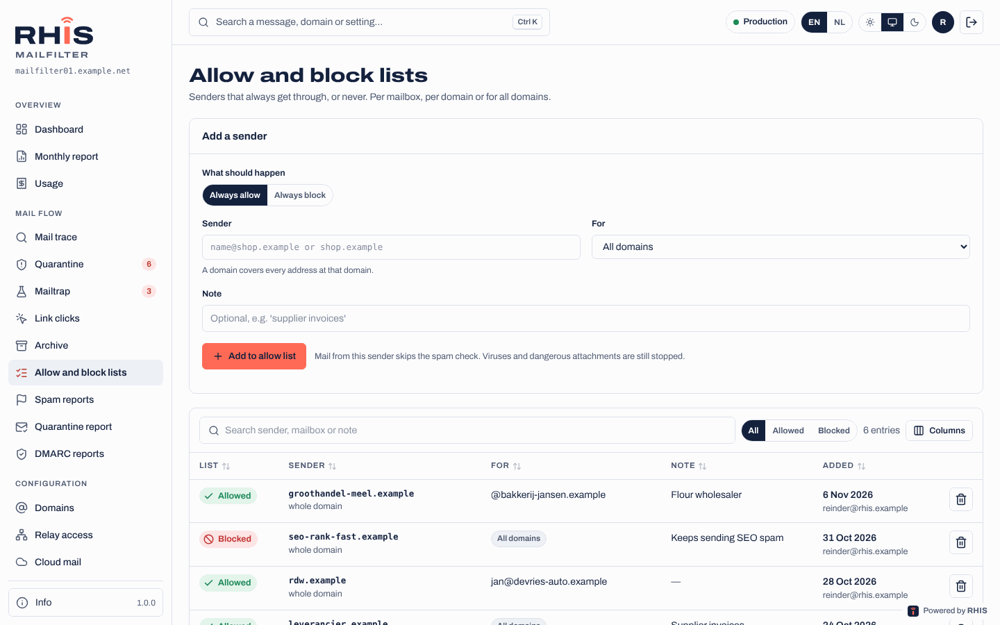

**Mailverkeer › Toestaan en blokkeren**: afzenders die altijd doorkomen, of nooit.

1. Kies **Altijd toestaan** of **Altijd blokkeren**.
2. Vul de **afzender** in: één adres (`naam@winkel.voorbeeld`) of een heel domein (`winkel.voorbeeld`).
3. Kies **voor wie**: één mailbox, iedereen op een van je domeinen, of (beheerders) alle domeinen.
4. Voeg eventueel een notitie toe, bijvoorbeeld *facturen leverancier*.

Toegestane afzenders slaan de spamcontrole over, maar virussen en gevaarlijke bijlagen worden nog steeds tegengehouden. Geblokkeerde afzenders worden geweigerd en krijgen een foutmelding. Wijzigingen werken binnen een minuut.

## 8. Spam en goede mail melden

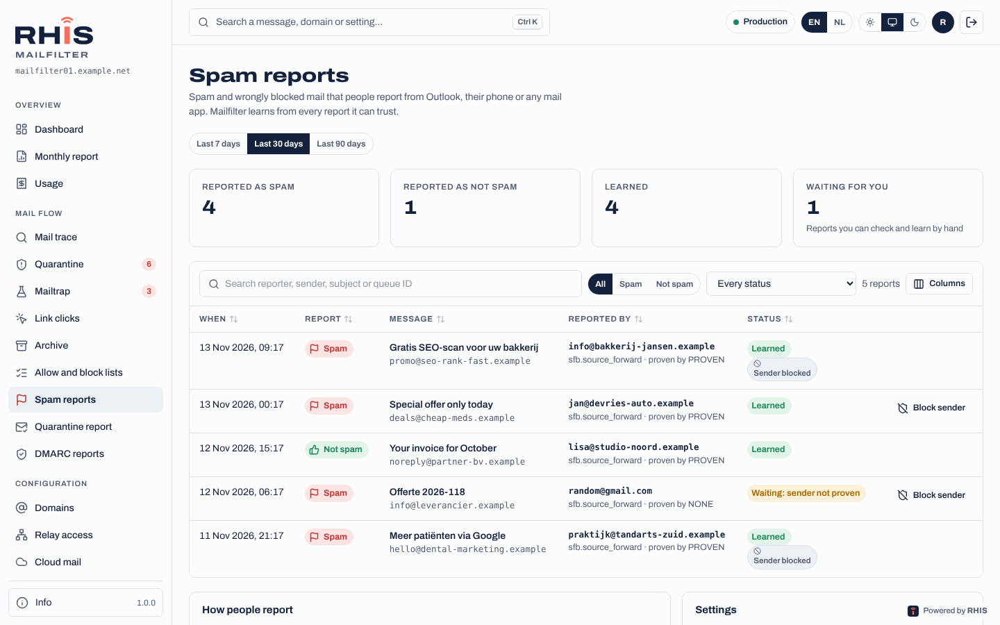

Kwam er spam door, of werd goede mail als spam gezien? Meld het, en Mailfilter leert ervan. De adressen staan onder **Mailverkeer › Spammeldingen**:

- spam gaat naar `spam@<hostnaam van mailfilter>`;
- goede mail die als spam werd gezien gaat naar `notspam@<hostnaam van mailfilter>`.

Zo meld je:

| Waar | Hoe |
| --- | --- |
| **Outlook met Microsoft 365** | Druk op de knop **Rapporteren**. Je beheerder stelt dit één keer per tenant in zodat meldingen naar Mailfilter gaan. Werkt op Windows, Mac, het web, iPhone en Android. |
| **Elk desktop- of webmailprogramma** | **Doorsturen als bijlage** naar het adres hierboven. Mailfilter krijgt dan precies het origineel. |
| **Telefoon** | Gebruik in de Outlook-app **Rapporteren**; in andere apps (iPhone Mail, Gmail) stuur je het bericht gewoon door. |

Voor de veiligheid leert Mailfilter alleen van mail die het zelf bij jouw domein heeft afgeleverd, gemeld vanaf jouw domein. Andere meldingen worden getoond maar nooit geleerd. De pagina Spammeldingen toont elke melding en wat ermee gedaan is.

## 9. DMARC-rapporten

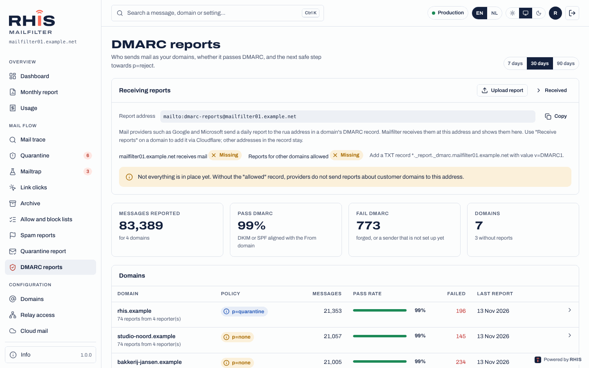

**Mailverkeer › DMARC-rapporten** toont wie mail verstuurt namens je domeinen en of die mail door DMARC komt. Grote mailproviders sturen dagelijks rapporten naar Mailfilter zodra je DMARC-record daarom vraagt.

- Per domein zie je het huidige beleid en de **weg naar p=reject**: *alleen meekijken*, dan *mail die faalt gaat naar spam* (`quarantine`), dan *mail die faalt wordt geweigerd* (`reject`, volledige bescherming).
- De lijst met **afzenders** toont elke server die namens je domein verstuurde, waar mogelijk herkend bij naam (Microsoft 365, Google, Mailchimp, je webserver…), met hoeveel er door SPF, DKIM en DMARC kwam.
- Los de afzenders op die falen (opnemen in SPF, DKIM instellen) voordat je beheerder het beleid een stap verder zet.

## 10. Je domeinen

**Configuratie › Domeinen** toont je domeinen in twee tabbladen:

- **Transportdomeinen** ontvangen mail via Mailfilter. Je ziet waar schone mail wordt afgeleverd (de mailserver en reserveservers), de afleverwachtrij, de versleuteling naar je mailserver en de verzendlimieten.
- **Relaydomeinen** versturen alleen mail via Mailfilter, bijvoorbeeld vanuit een webshop. Je ziet de status van DKIM, SPF en DMARC en welke servers en SMTP-accounts namens het domein mogen versturen.

In het onderdeel **Ontvangers** van een transportdomein zie je hoe Mailfilter controleert of een adres bestaat voordat het mail ervoor aanneemt (door het je mailserver te vragen, via LDAP / Active Directory, of met een vaste lijst). Met **Testen** probeer je een adres. Mail voor adressen die niet bestaan wordt direct geweigerd, dus hij komt nooit in de quarantaine en niemand krijgt valse bounces.

## 11. Relay-toegang: servers die mail versturen

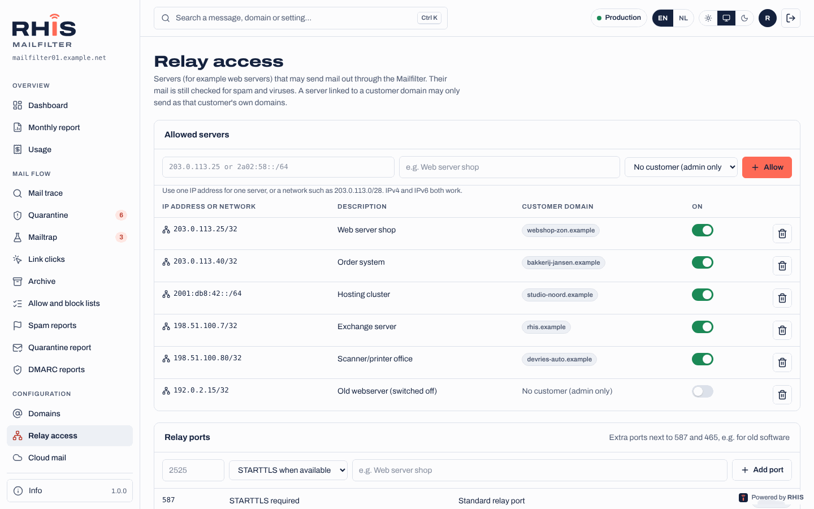

**Configuratie › Relay-toegang** toont je servers (webservers, applicaties, printers) die via Mailfilter mail naar buiten mogen sturen.

1. Druk op **Toestaan**, vul het **IP-adres** (IPv4 of IPv6) of een klein netwerk in, en een omschrijving zoals *webserver webshop*.
2. Stel de server in om te versturen via de hostnaam van Mailfilter op poort 587 (STARTTLS) of 465 (TLS). Vanaf een toegestaan IP is geen wachtwoord nodig.

Je servers mogen alleen versturen namens je eigen domeinen. Hun mail wordt nog steeds op spam en virussen gecontroleerd, met DKIM ondertekend en begrensd, zodat een gehackte website geen duizenden berichten kan versturen.

Servers zonder vast IP-adres gebruiken in plaats daarvan een **SMTP-account** (in te stellen bij het relaydomein, zie [relaydomeinen](relay-domeinen.md)). Het wachtwoord wordt één keer getoond.

### Een gepauzeerde afzender

Als een van je servers of accounts plotseling spam of veel meer mail dan normaal verstuurt, **pauzeert** Mailfilter hem: zijn mail wordt vastgehouden, er gaat niets verloren en er wordt niets verstuurd. Je ziet een rode balk met de reden, bijvoorbeeld *42 van 50 berichten in 10 minuten waren spam*.

1. Zoek en verhelp eerst de oorzaak: wachtwoord wijzigen, website bijwerken, kwaadaardig script verwijderen.
2. Vraag je beheerder de afzender vrij te geven (of doe het zelf als je dat mag). Die kiest of de vastgehouden mail **verstuurd** of **verwijderd** wordt.

## 12. Eigen regels

**Configuratie › Eigen regels** toont extra filterregels, elk met uitleg onder **Wat doet dit?**: nieuwsbriefregels, bescherming tegen phishing en CEO-fraude, bijlageregels, doorgestuurde mail (ARC). Je beheerder bepaalt de standaard; per domein kies je **Standaard**, **Aan** of **Uit**. In de mailtrace zie je de naam van een regel als hij raakte.

Met **Links controleren bij het klikken** aan worden links in binnenkomende mail opnieuw gecontroleerd op het moment dat iemand klikt; een gevaarlijke site geeft een waarschuwings- of blokkadepagina. **Mailverkeer › Linkklikken** toont elke klik voor je domeinen. Zie [Linkbescherming](linkbescherming.md).

## 13. Mailtrap

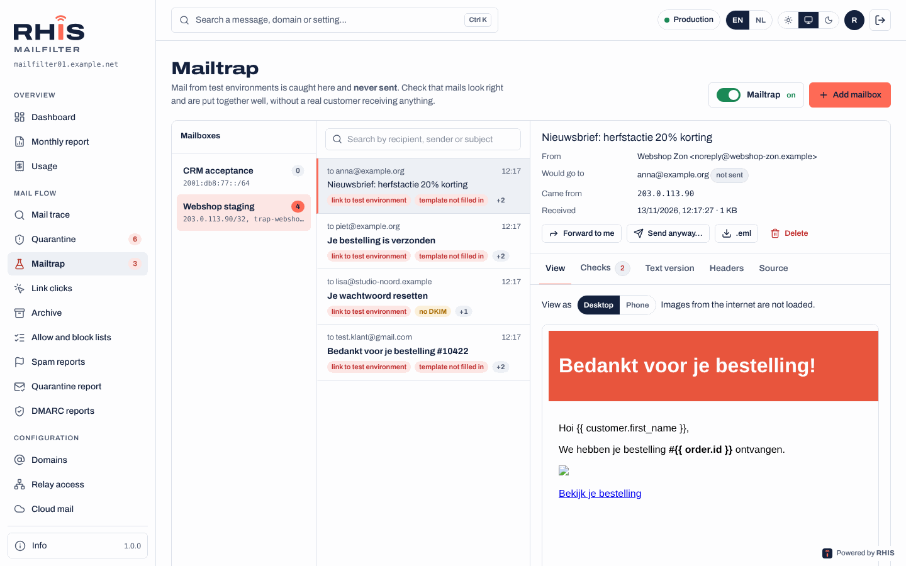

**Mailverkeer › Mailtrap** (als je beheerder hem heeft aangezet) vangt alle mail van je **test- en acceptatieomgevingen** op, zodat die **nooit** naar echte mensen wordt verstuurd. De mail komt in een Mailtrap-mailbox waar je hem kunt lezen en controleren.

- Elk bericht heeft labels voor gevonden problemen. Open het om te zien:
  - **Weergave**: de HTML zoals de ontvanger hem ziet, op desktop- of telefoonbreedte (afbeeldingen van internet worden niet geladen);
  - **Controle**: spamscore, links naar testhosts of zonder HTTPS, niet-ingevulde templatevelden (`{{ order.id }}`), DKIM, From tegenover envelope-afzender, HTML- en tekstdeel, afbeeldingen zonder alt-tekst, grootte (Gmail knipt af boven 102 KB), onderwerp, datum, afmeldheaders, bijlagen;
  - **Tekstversie**, **Headers** en **Bron** (download als `.eml`).
- **Doorsturen naar mij** stuurt een kopie naar je eigen adres.
- Met **Alles opvangen, behalve naar testers** krijgen adressen op de testerslijst de mail echt, en blijft er een kopie in de Mailtrap.
- Je kunt een Mailtrap-mailbox ook in een mailprogramma lezen via **IMAP** (poort 993, TLS) met de login `trap-<naam>`.

Zie [Mailtrap](mailtrap.md) voor alle details.

## 14. Archief

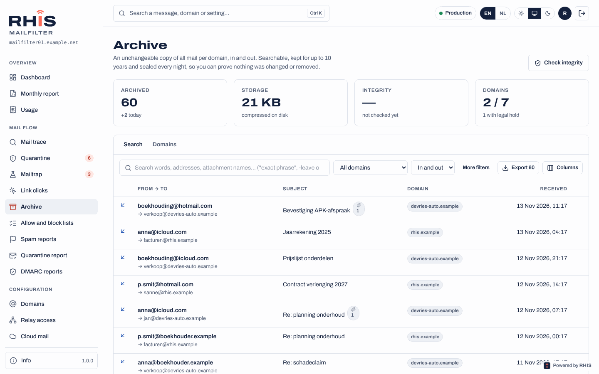

**Mailverkeer › Archief** (als het voor je domein aanstaat) bewaart een **onveranderbare kopie van alle mail** die je domein verstuurde en ontving, tot 10 jaar.

- **Zoeken** op woorden, adressen of namen van bijlagen; gebruik `"exacte zin"` en `-woord` om iets uit te sluiten. Filter op domein, richting en datum.
- Open een bericht om het te lezen of te **downloaden** als `.eml`.
- **Exporteer** een selectie als zip met de `.eml`-bestanden en het bewijs dat er niets veranderd is (vingerafdrukken, hashketen en ondertekende dagzegels).
- Een **juridische bewaarplicht** (ingesteld door een beheerder) bewaart alles van een domein, ook na de bewaartermijn, voor een geschil of onderzoek.

Elke zoekopdracht, weergave, download en export komt in het auditlog. Zie [archief](archief.md).

## 15. Maandrapport en verbruik

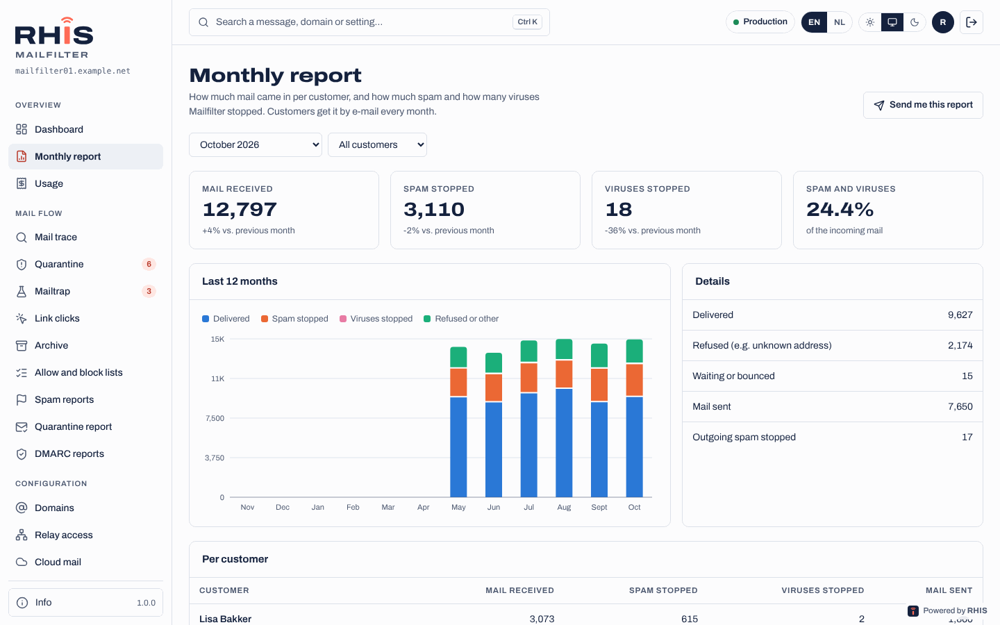

- **Overzicht › Maandrapport**: hoeveel mail er vorige maand voor je domeinen binnenkwam, en hoeveel spam en virussen Mailfilter tegenhield. Als je beheerder het aanzet krijg je het ook aan het begin van elke maand per e-mail; met **Stuur mij dit rapport elke maand** zet je je eigen exemplaar aan of uit.
- **Overzicht › Verbruik**: wat je deze maand gebruikte: domeinen, actieve mailboxen, mailverkeer en archiefopslag. Resellers zien dit voor hun eigen klanten, met prijzen; klanten zien de aantallen.

## 16. API-sleutels

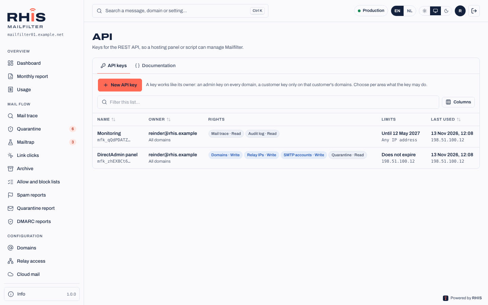

**Systeem › API** koppelt een hostingpaneel of script aan Mailfilter.

1. **API-sleutels › Nieuwe API-sleutel**: geef een naam en kies per onderdeel wat hij mag (**geen**, **lezen**, **schrijven**): domeinen, relay-toegang, SMTP-accounts, quarantaine, mailtrace, lijsten, auditlog.
2. Beperk hem eventueel tot IP-adressen en stel een vervaldatum in.
3. Kopieer de sleutel (`mfk_…`). Hij wordt maar één keer getoond.

Een sleutel van een klant werkt alleen op de domeinen van die klant. Alles wat met een sleutel gebeurt staat in het auditlog als *via API-sleutel*. Het tabblad **Documentatie** beschrijft elke aanroep. Zie [REST API](api.md).

## 17. Auditlog

**Systeem › Auditlog** toont elke wijziging: wie wat deed, wanneer, op welk domein en vanaf welk IP-adres, inclusief vrijgaven uit de quarantaine en zoekopdrachten in het archief. Filter op persoon, actie, domein en periode, en exporteer naar CSV. Klanten zien hun eigen acties en wijzigingen aan hun domeinen.

## 18. Wat de statussen betekenen

| Status | Betekenis |
| --- | --- |
| **Afgeleverd** | De ontvangende mailserver heeft het bericht aangenomen. Vanaf hier is die server verantwoordelijk (inbox, map ongewenste mail, regels). |
| **Vertraagd** | De ontvangende server is tijdelijk niet bereikbaar of vroeg om het later te proberen. Mailfilter blijft het tot 5 dagen proberen. |
| **Niet afgeleverd** | De ontvangende server weigerde het bericht definitief. De reden en wie het kan oplossen staan erbij. De afzender krijgt een bounce. |
| **In quarantaine** | Vastgehouden als spam of gevaarlijk. Geef het vrij als het goede mail is. |
| **Geweigerd** | Aan de deur geweigerd: het adres bestaat niet, de afzender is geblokkeerd, de server mag niet relayen, of het bericht was duidelijk spam of een virus. Er is niets opgeslagen. |
| **Opgevangen in Mailtrap** | Mail uit een testomgeving; niet verstuurd. |

## 19. Veelgestelde vragen

**Een klant zegt dat hij me een mail stuurde, maar ik heb niets gekregen.**
Zoek zijn adres in de mailtrace in de juiste periode. Staat er niets, dan heeft de mail Mailfilter nooit bereikt: vraag de afzender om zijn foutmelding. Staat hij in quarantaine, geef hem vrij. Is hij afgeleverd, kijk dan in de map ongewenste mail en de regels van de mailbox.

**Mijn mail aan iemand anders komt niet aan.**
Zoek de ontvanger in de mailtrace (richting *Uitgaand*). De uitleg vertelt of de ontvangende server hem weigerde en waarom, bijvoorbeeld een volle mailbox of een ontbrekend SPF-record.

**Goede mail komt steeds in quarantaine.**
Geef hem vrij (het filter leert daarvan) en zet de afzender met **Altijd toestaan** op je toestaanlijst.

**Er komt te veel spam door.**
Meld het bij `spam@…` zoals hierboven beschreven, en blokkeer hardnekkige afzenders. Vraag je beheerder naar de eigen regels te kijken.

**Ik ben mijn telefoon met de authenticator-app kwijt.**
Log in met een van je herstelcodes en stel tweestapsverificatie opnieuw in. Geen codes meer? Vraag een beheerder om het te resetten.
