# User manual

[Nederlands](nl/gebruikershandleiding.md) · [All documentation](README.md)

This manual is for everybody who works with Mailfilter day to day: customers who look after their own domains, and administrators who want to know what their customers see. Settings that only administrators can change are in the [administrator manual](admin-guide.md).

**Contents**

1. [Signing in and your account](#1-signing-in-and-your-account)
2. [Finding your way](#2-finding-your-way)
3. [Dashboard](#3-dashboard)
4. [Mail trace](#4-mail-trace)
5. [Quarantine](#5-quarantine)
6. [The daily quarantine report](#6-the-daily-quarantine-report)
7. [Allow and block lists](#7-allow-and-block-lists)
8. [Reporting spam and good mail](#8-reporting-spam-and-good-mail)
9. [DMARC reports](#9-dmarc-reports)
10. [Your domains](#10-your-domains)
11. [Relay access: servers that send mail](#11-relay-access-servers-that-send-mail)
12. [Custom rules](#12-custom-rules)
13. [Mailtrap](#13-mailtrap)
14. [Archive](#14-archive)
15. [Monthly report and usage](#15-monthly-report-and-usage)
16. [API keys](#16-api-keys)
17. [Audit log](#17-audit-log)
18. [What the statuses mean](#18-what-the-statuses-mean)
19. [Frequently asked questions](#19-frequently-asked-questions)

## What you can see

Mailfilter has three kinds of logins:

| Role | Sees |
| --- | --- |
| **Admin** | Everything, on every domain, and all settings |
| **Customer** | Only mail from and to the domains linked to the account, and the settings of those domains |
| **Reseller** | Only the usage of its own customers (for invoicing) |

Everything in this manual is limited to your own domains when you sign in as a customer.

## 1. Signing in and your account

Open the address your administrator gave you, for example `https://mailfilter01.example.nl/`, and sign in with your e-mail address and password. The web interface only works over HTTPS.

**My account** (your initials at the top right) has:

- **Name** and **language**: English or Nederlands. You can also switch language at any moment with **EN / NL** at the top right.
- **Change password**: at least 10 characters. Your other sessions are signed out.
- **Two-factor login**: protects your account with a 6-digit code from an authenticator app (Microsoft Authenticator, Google Authenticator, 1Password, Bitwarden, …).
  1. Press **Set up two-factor login**.
  2. Scan the QR code with the app (or type in the key).
  3. Enter the code the app shows and press **Turn on**.
  4. **Save the recovery codes.** Each one lets you sign in once without your phone.

  From then on Mailfilter asks for a code after your password. Lost your phone? Use a recovery code, or ask an administrator to reset two-factor login for you. Your administrator can require two-factor login; you are then asked to set it up at your next sign-in.

The **theme** switch at the top right chooses light, dark or the same as your computer.

## 2. Finding your way

- The **menu on the left** has four groups: **Overview**, **Mail flow**, **Configuration** and **System**. You only see the items you may use. On a phone the menu opens with the ☰ button.
- **Search everything** with **Ctrl+K** (⌘K on a Mac) or the search bar at the top: pages, domains, users and messages.
- **Info** at the bottom of the menu shows the version of Mailfilter and whether it runs the production or test channel.
- Lists have a **filter**, can be **sorted** by clicking a column and you choose the **columns** you want to see; on a phone they become cards.
- Changes are saved when you press **Save**; a short message at the bottom confirms it.

## 3. Dashboard

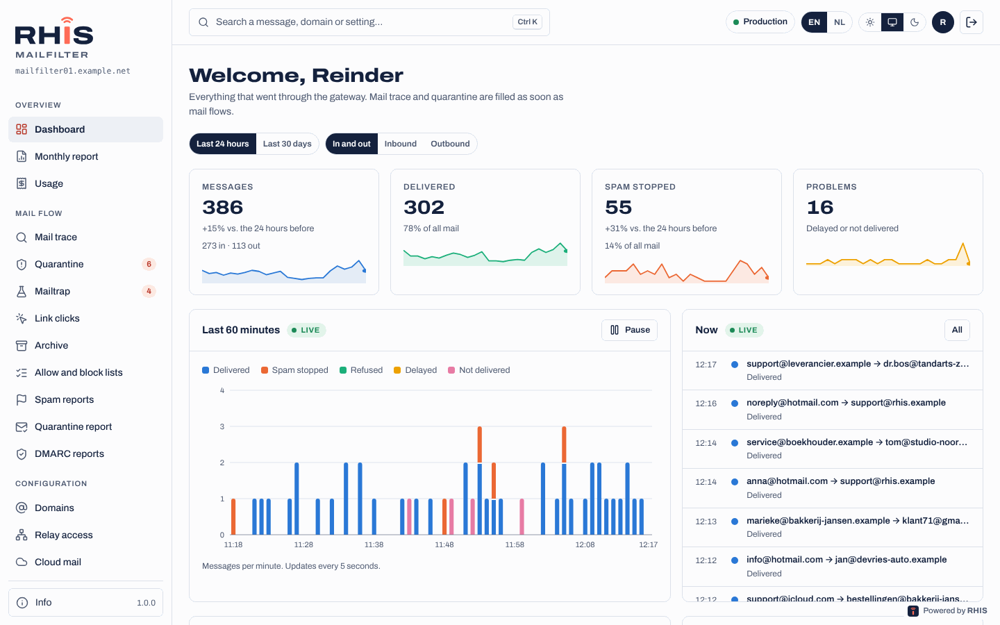

The dashboard shows mail for the last 24 hours or the last 30 days:

- **Messages** in and out, **Delivered**, **Spam stopped**, **Problems** (delayed or not delivered) and **In quarantine**, each compared with the period before.
- A chart of mail per hour or per day, split into delivered, spam stopped, refused, delayed and not delivered. **Show as table** gives the numbers.
- **Things to look at**: mail stuck for more than an hour, many bounces, a server sending far more than usual, a paused sender, messages waiting in quarantine. Click a line to go straight to the messages.
- **Recent problems**, **top senders** and **top recipient domains**.

Administrators also see the mail queue, services that are not running and blocklist listings of the server.

## 4. Mail trace

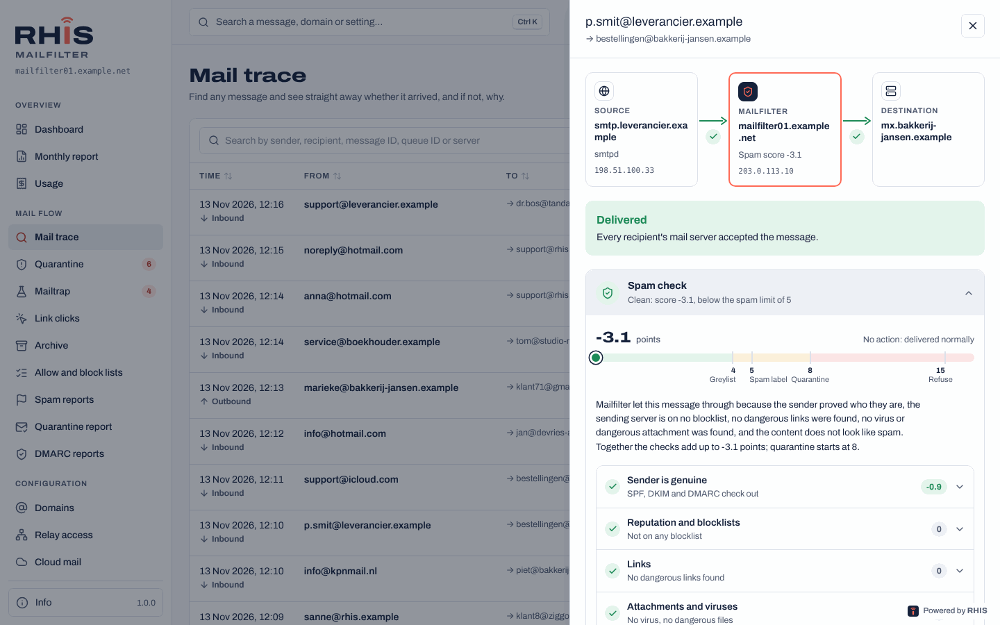

**Mail flow › Mail trace** answers *did this message arrive, and if not, why?*

1. Type a **sender, recipient, message ID, queue ID or server name** (or part of it) in the search field.
2. Narrow down by **status** (delivered, problems only, delayed, not delivered, in quarantine, refused, caught in Mailtrap), **direction** (inbound, outbound) and **period** (last hour up to 90 days).
3. Click a message to open it.

The message panel shows:

- A **route picture**: the sending server, Mailfilter (with the spam score) and the destination, with a green check or a red cross on each step.
- **Per recipient** what happened, with the answer of the receiving server and an explanation **in plain language** of what it means and **who can fix it**: the sender, the recipient, the Mailfilter administrator, or *usually solves itself* (Mailfilter keeps trying).
- Received time, queue ID, size, spam score, the SMTP account that sent it, and links between a message and its bounces.
- **Spam check**: a checklist of everything the spam filter looked at (authentication, reputation, links, attachments, content, format, policy) with what it found and how much it counted. This explains why a message was let through or stopped.
- If the message was in quarantine: who released or blocked it, and what the spam filter learned.

The mail trace keeps 90 days.

## 5. Quarantine

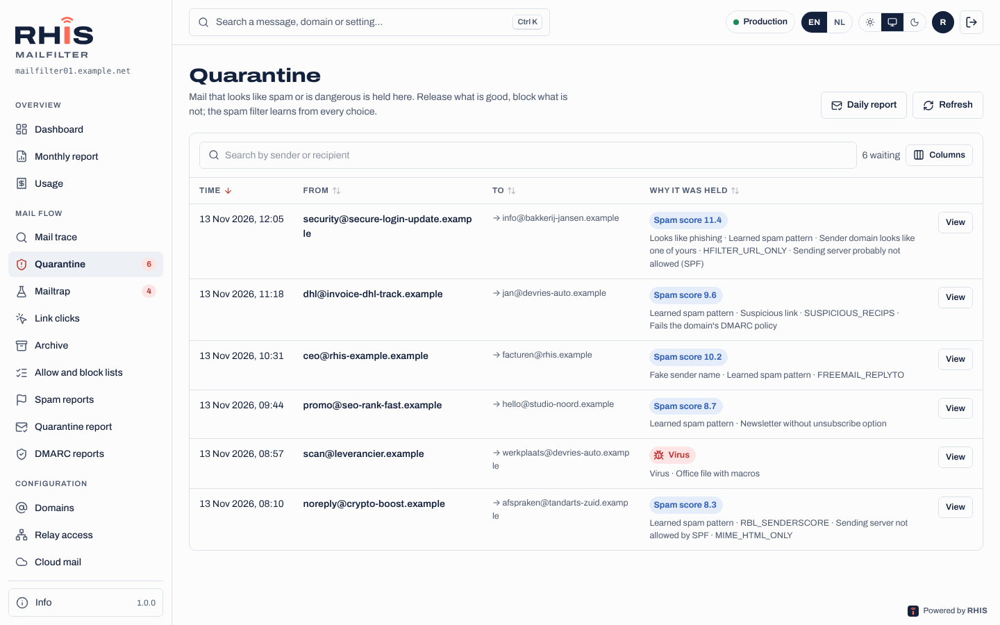

**Mail flow › Quarantine** holds mail that looks like spam or is dangerous. The number next to the menu item shows how many messages are waiting.

- Click a message to see **why it was held** (spam score, virus, blocked attachment), the sender, the recipients, the attachments and the **content as plain text**. Links and images are not loaded, so looking is safe.
- **Release**: the message is delivered right away, and the spam filter learns *this is good mail*.
- **Block and delete**: the message is deleted, and the spam filter learns *this is spam*.
- **Always allow** / **Always block** puts the sender on the allow or block list of that recipient in one go.
- **Show in mail trace** opens the full history.

Messages with a **virus** can only be released by an administrator.

## 6. The daily quarantine report

When your administrator switches it on, every recipient with held mail gets **one e-mail a day** listing those messages. Each message has a button that opens a small page (no login needed) with three choices:

- **Release this message only**
- **Release and always allow this sender**
- **Block this sender**

Opening the link changes nothing; only pressing a button does. A link works for 14 days and only for that one message. Mail with a virus is listed, but only an administrator can release it.

## 7. Allow and block lists

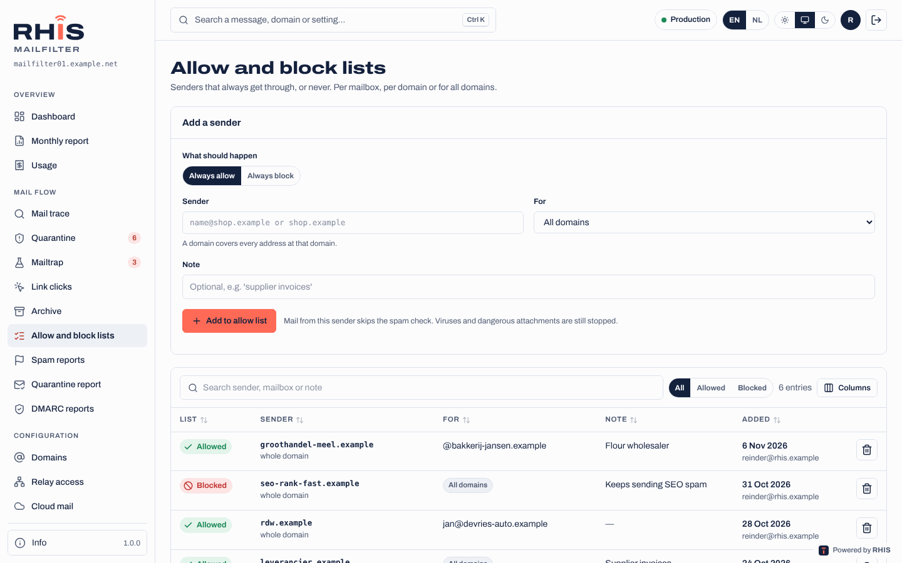

**Mail flow › Allow and block lists**: senders that always get through, or never.

1. Choose **Always allow** or **Always block**.
2. Enter the **sender**: one address (`name@shop.example`) or a whole domain (`shop.example`).
3. Choose **for whom**: one mailbox, everyone at one of your domains, or (admins) all domains.
4. Optionally add a note, for example *supplier invoices*.

Allowed senders skip the spam check, but viruses and dangerous attachments are still stopped. Blocked senders are refused and get an error message. Changes take effect within a minute.

## 8. Reporting spam and good mail

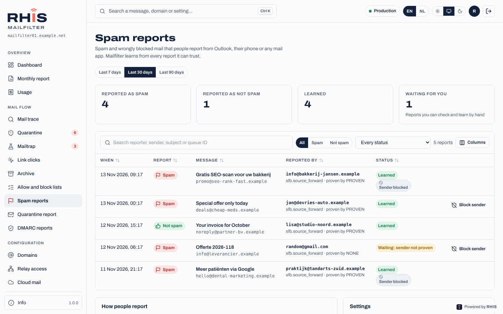

Did spam get through, or was good mail marked as spam? Report it, and Mailfilter learns from it. The addresses are shown under **Mail flow › Spam reports**:

- spam goes to `spam@<mailfilter host name>`;
- good mail that was marked as spam goes to `notspam@<mailfilter host name>`.

How to report:

| Where | How |
| --- | --- |
| **Outlook with Microsoft 365** | Press the **Report** button. Your administrator sets it up once per tenant so reports go to Mailfilter. Works on Windows, Mac, the web, iPhone and Android. |
| **Any desktop or web mail program** | **Forward as attachment** to the address above. Mailfilter gets the exact original. |
| **Phone** | In the Outlook app use **Report**; in other apps (iPhone Mail, Gmail) simply forward the message. |

For safety Mailfilter only learns from mail that it delivered to your domain, reported from your domain. Other reports are listed but never learned. The Spam reports page shows every report and what was done with it.

## 9. DMARC reports

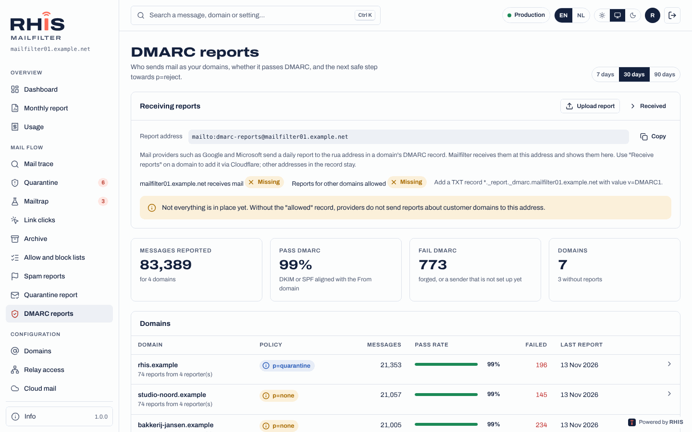

**Mail flow › DMARC reports** shows who sends mail as your domains and whether that mail passes DMARC. Big mail providers send daily reports to Mailfilter once your DMARC record asks for them.

- Per domain you see the current policy and the **road to p=reject**: *monitor only*, then *failing mail goes to spam* (`quarantine`), then *failing mail is refused* (`reject`, full protection).
- The **senders** list shows each server that sent as your domain, recognised by name where possible (Microsoft 365, Google, Mailchimp, your web server…), with how much passed SPF, DKIM and DMARC.
- Fix the senders that fail (add them to SPF, set up DKIM) before your administrator moves the policy to the next step.

## 10. Your domains

**Configuration › Domains** lists your domains in two tabs:

- **Transport domains** receive mail through Mailfilter. You see where clean mail is delivered (the mail server and backup servers), the delivery queue, the encryption to your mail server and the sending limits.
- **Relay domains** only send mail through Mailfilter, for example from a web shop. You see the DKIM, SPF and DMARC status and which servers and SMTP accounts may send for the domain.

In the **Recipients** section of a transport domain you see how Mailfilter checks that an address exists before accepting mail for it (by asking your mail server, through LDAP / Active Directory, or a fixed list). **Test** lets you try an address. Mail for addresses that do not exist is refused straight away, so it never reaches quarantine and nobody gets fake bounces.

## 11. Relay access: servers that send mail

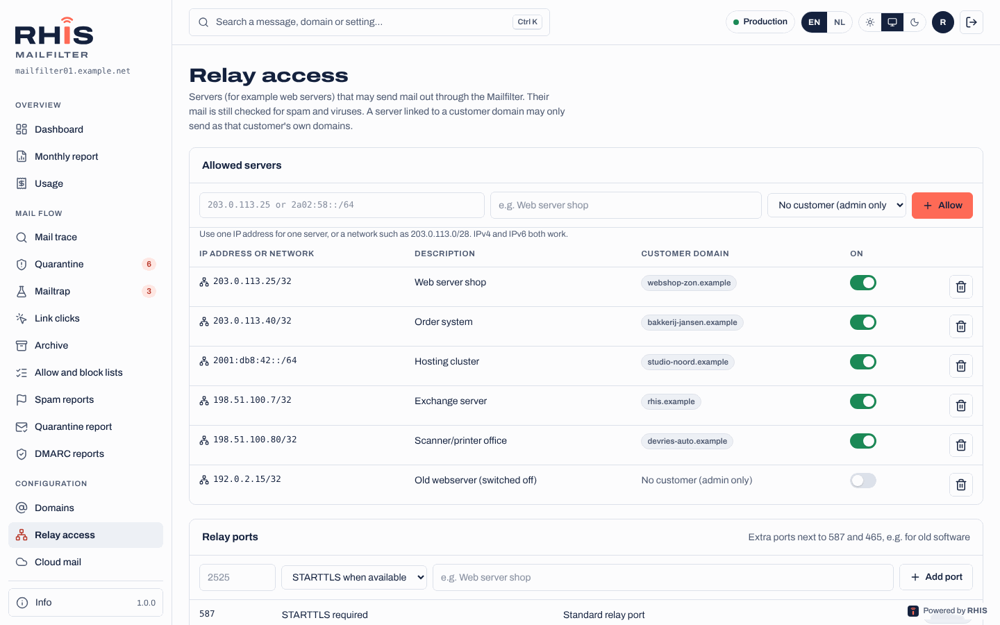

**Configuration › Relay access** lists your servers (web servers, applications, printers) that may send mail out through Mailfilter.

1. Press **Allow**, enter the **IP address** (IPv4 or IPv6) or a small network, and a description such as *web server shop*.
2. Configure the server to send through the Mailfilter host name on port 587 (STARTTLS) or 465 (TLS). No password is needed from an allowed IP.

Your servers may only send as your own domains. Their mail is still checked for spam and viruses, DKIM-signed and limited, so a hacked website cannot send thousands of messages.

Servers without a fixed IP address use an **SMTP account** instead (set up on the relay domain, see [relay domains](relay-domains.md)). The password is shown once.

### A paused sender

If one of your servers or accounts suddenly sends spam or far more mail than usual, Mailfilter **pauses** it: its mail is held, nothing is lost and nothing is sent. You see a red banner with the reason, for example *42 of 50 messages in 10 minutes were spam*.

1. Find and fix the cause first: change the password, update the website, remove the malicious script.
2. Ask your administrator to release the sender (or release it yourself if you are allowed). They choose to **send** or **delete** the held mail.

## 12. Custom rules

**Configuration › Custom rules** shows extra filter rules, each with an explanation under **What does this do?**: newsletter rules, phishing and CEO fraud protection, attachment rules, forwarded mail (ARC). Your administrator sets the default; for each of your domains you can choose **Default**, **On** or **Off**. The trace shows a rule's name when it fired.

With **Check links when they are clicked** on, links in incoming mail are checked again at the moment someone clicks them; a dangerous site shows a warning or block page. **Mail flow › Link clicks** lists every click for your domains. See [Link protection](link-protection.md).

## 13. Mailtrap

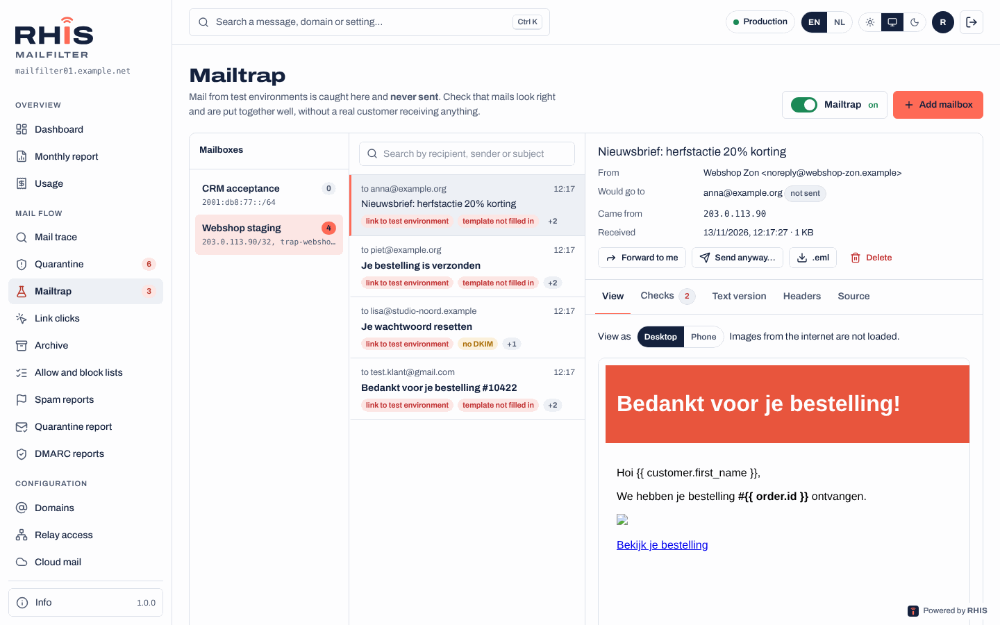

**Mail flow › Mailtrap** (when your administrator has switched it on) catches all mail from your **test and staging environments**, so it is **never sent** to real people. The mail lands in a Mailtrap mailbox where you can read and check it.

- Each message has chips for problems found. Open it to see:
  - **View**: the HTML as the recipient would see it, at desktop or phone width (images from the internet are not loaded);
  - **Check**: spam score, links to test hosts or without HTTPS, template fields that were not filled in (`{{ order.id }}`), DKIM, From vs. envelope sender, HTML and text part, images without alt text, size (Gmail clips above 102 KB), subject, date, unsubscribe headers, attachments;
  - **Text version**, **Headers** and **Source** (download as `.eml`).
- **Forward to me** sends a copy to your own address.
- With **Catch everything, except mail to testers**, addresses on the testers list get the mail for real, and a copy stays in the Mailtrap.
- You can also read a Mailtrap mailbox in a mail program over **IMAP** (port 993, TLS) with the login `trap-<name>`.

See [Mailtrap](mailtrap.md) for all details.

## 14. Archive

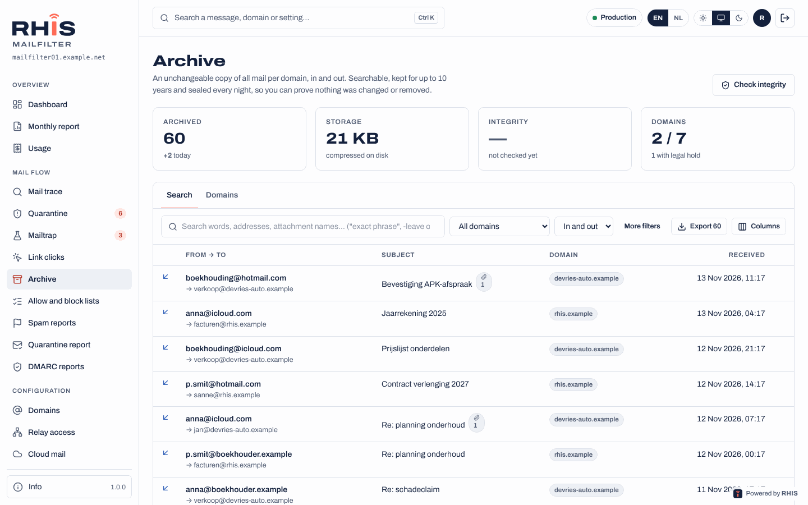

**Mail flow › Archive** (when switched on for your domain) keeps an **unchangeable copy of all mail** your domain sent and received, for up to 10 years.

- **Search** by words, addresses or attachment names; use `"exact phrase"` and `-word` to leave something out. Filter by domain, direction and date.
- Open a message to read it or **download** it as `.eml`.
- **Export** a selection as a zip with the `.eml` files and proof that nothing was changed (fingerprints, hash chain and signed day seals).
- A **legal hold** (set by an administrator) keeps everything of a domain, even past the retention period, for a dispute or investigation.

Every search, view, download and export is written to the audit log. See [archive](archive.md).

## 15. Monthly report and usage

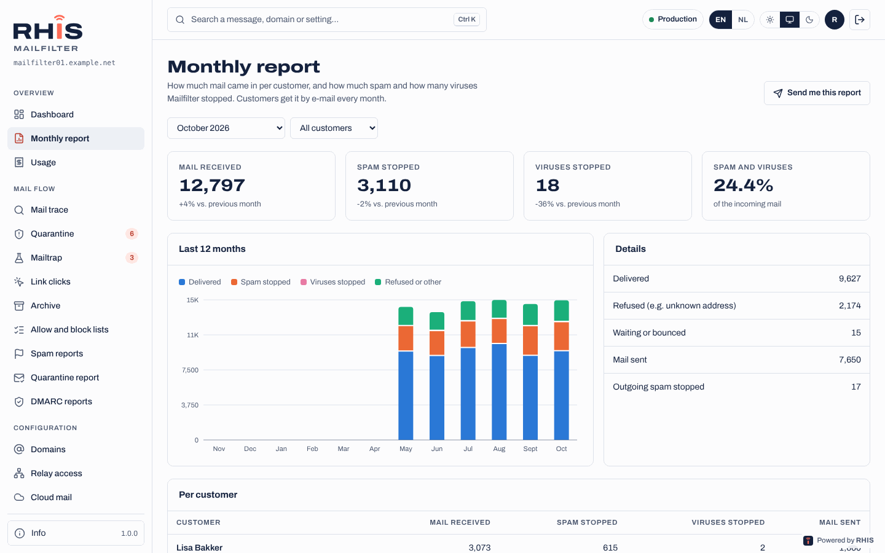

- **Overview › Monthly report**: how much mail came in for your domains last month, and how much spam and how many viruses Mailfilter stopped. When your administrator switches it on you also get it by e-mail at the start of each month; you can turn your own copy off there.
- **Overview › Usage**: what you used this month: domains, active mailboxes, mail traffic and archive storage. Resellers see this for their own customers, with prices; customers see the quantities.

## 16. API keys

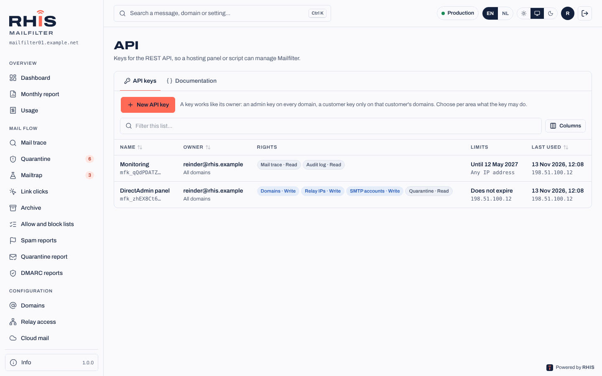

**System › API** lets you connect a hosting panel or script to Mailfilter.

1. **API keys › New key**: give it a name, choose per area what it may do (**none**, **read**, **write**): domains, relay access, SMTP accounts, quarantine, mail trace, lists, audit log.
2. Optionally limit it to IP addresses and set an expiry date.
3. Copy the key (`mfk_…`). It is shown only once.

A customer key only works on that customer's domains. Everything done with a key appears in the audit log as *via API key*. The **Documentation** tab describes every call. See [REST API](api.md).

## 17. Audit log

**System › Audit log** lists every change: who did what, when, on which domain and from which IP address, including releases from quarantine and archive searches. Filter by person, action, domain and period, and export to CSV. Customers see their own actions and changes to their domains.

## 18. What the statuses mean

| Status | Meaning |
| --- | --- |
| **Delivered** | The receiving mail server accepted the message. From here on it is that server's responsibility (inbox, junk folder, rules). |
| **Delayed** | The receiving server is temporarily unavailable or asked to try later. Mailfilter keeps trying for up to 5 days. |
| **Not delivered** | The receiving server refused the message for good. The reason and who can fix it are shown. The sender gets a bounce. |
| **In quarantine** | Held as spam or dangerous. Release it if it is good mail. |
| **Refused** | Refused at the door: the address does not exist, the sender is blocked, the server may not relay, or the message was clearly spam or a virus. Nothing was stored. |
| **Caught in Mailtrap** | Mail from a test environment; not sent (test environment). |

## 19. Frequently asked questions

**A customer says they sent me a mail but I did not get it.**
Search their address in the mail trace for the right period. If nothing shows, the mail never reached Mailfilter: ask the sender for their bounce message. If it is in quarantine, release it. If it was delivered, look in the junk folder and rules of the mailbox.

**My mail to someone else does not arrive.**
Search the recipient in the mail trace (direction *outbound*). The explanation tells you whether the receiving server refused it and why, for example a full mailbox or a missing SPF record.

**Good mail keeps landing in quarantine.**
Release it (the filter learns from that) and put the sender on your allow list with **Always allow**.

**Too much spam gets through.**
Report it to `spam@…` as described above, and block persistent senders. Ask your administrator to look at the custom rules.

**I lost my phone with the authenticator app.**
Sign in with one of your recovery codes, then set up two-factor login again. No codes left? Ask an administrator to reset it.
